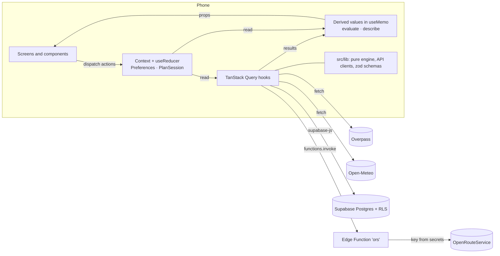
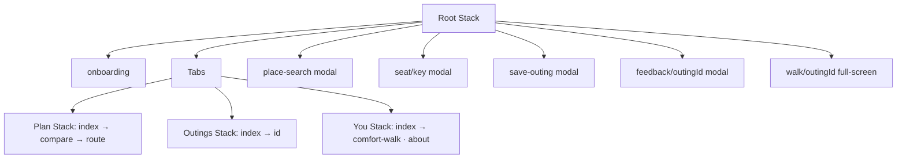

# Benchmark on open data: the full build plan

[Original proposal](../proposals/01-benchmark.md) · [Shared build guide](../proposals/08-project-build-guide.md) · [Proposal comparison](../proposals/00-final-project-ideas.md)

Benchmark (called Bench Ahead until November 16) answers one question before and during a walk: *how far will I have to go before I can sit down, and is there a route that keeps every stretch within my limit?* The [first version of the proposal](../proposals/01-benchmark.md) answered it with benches that the team would inspect by hand. This plan answers it with public map data, real walking routes, and confirmations that walkers add while they use the app, so it works on any campus or neighbourhood that OpenStreetMap covers and needs no data collection by the team.

Written on November 16, 2026. The Overpass query, the Turf calculations, the colour contrast figures, and the icon renders in this document were run that day. OpenRouteService, MapLibre, Supabase, and Open-Meteo details come from their current documentation; anything marked **verify in the spike** has not yet been exercised with a real key on a phone.

## Contents

1. [Why the plan changed](#1-why-the-plan-changed)
2. [The app in brief](#2-the-app-in-brief)
3. [Simplest workable choices](#3-simplest-workable-choices)
4. [Data sources and the wording each one allows](#4-data-sources-and-the-wording-each-one-allows)
5. [Architecture and one-way data flow](#5-architecture-and-one-way-data-flow)
6. [Navigation](#6-navigation)
7. [Screens, layouts, and interactions](#7-screens-layouts-and-interactions)
8. [The rest-gap engine](#8-the-rest-gap-engine)
9. [External API clients](#9-external-api-clients)
10. [Supabase: schema, security, and hooks](#10-supabase-schema-security-and-hooks)
11. [Design system, icon, and splash](#11-design-system-icon-and-splash)
12. [Accessibility plan](#12-accessibility-plan)
13. [Libraries and setup](#13-libraries-and-setup)
14. [Schedule and team split](#14-schedule-and-team-split)
15. [Testing and verification](#15-testing-and-verification)
16. [Adversarial review and fixes](#16-adversarial-review-and-fixes)
17. [Demo script](#17-demo-script)
18. [Stretch goals](#18-stretch-goals)
19. [Sources](#19-sources)

---

## 1. Why the plan changed

The first proposal asked teammates to walk a pilot area, inspect each seat, and store the results in a `pilot_places` table. That work has to be repeated for every new path, it confines the app to one small area, and it goes stale the first time a bench is moved. The decision at the centre of the app is still the right one, so this plan keeps it and changes where the information comes from.

| First proposal | Problem | This plan |
|---|---|---|
| The team inspects a handful of seats and stores them in Supabase | Field work for every path; one campus only | Seats come from OpenStreetMap through the Overpass API, wherever the map has data |
| Labels such as "Inspected on November 8" | The team can no longer make that claim | "Map entry last edited in OpenStreetMap, March 2025" and "Seen by another walker on Nov 10" |
| One fixed start and two destinations | Artificial, and useless off campus | Start from the current location or a map point, search for any destination within 5 km, or ask for a loop of a chosen length |
| A direct route and one alternative chosen by the team | Alternatives picked by hand | OpenRouteService alternatives, then a search that adds seats as waypoints until every stretch fits, capped at four route requests |
| A return arrangement recorded when saving | Still needed | Kept; loop walks remove the problem for many outings, and a same-way return gets its own rest check |
| Unknown seats never split a stretch | Still correct | Kept, with "unknown" defined by what the person needs: a bench with no backrest tag is unknown only to someone who needs a backrest |

### What the open data looks like

On November 16, 2026 an Overpass query for a box of roughly 1.0 km × 1.0 km around Stanford's Main Quad (`37.4220,-122.1750,37.4310,-122.1640`) returned **107 benches** (85 mapped as points, 22 as short lines), **72 picnic tables**, **13 bus stops tagged `bench=yes`**, 7 toilets, and 3 drinking fountains. Of the 107 benches, 50 record `backrest`, 13 record `material`, 4 record `armrest`, and **none** carry a `check_date`. Their last edits range from March 2017 to July 2026.

Running the rest-gap engine from [section 8](#8-the-rest-gap-engine) over that data, on a 949 m test line across campus, found 10 seats within 15 m of the line. With no seating requirement, all 10 counted and the longest stretch was 454 m. With "I need a backrest" switched on, 9 of the 10 became *unknown* and one picnic table was excluded, so the longest stretch became the whole 949 m.

Two design decisions follow from those numbers. Freshness labels have to rely on the last-edit date that `out meta` returns, because almost nobody records `check_date` here. And the backrest rule, applied honestly, leaves very few seats that count, so letting walkers answer "Does it have a backrest?" is a core feature of this plan, not an extra. Armrests are recorded on 4 of 107 benches, which is too sparse to use in the arithmetic; the app leaves them out for now ([section 18](#18-stretch-goals) describes how community answers could bring them back).

## 2. The app in brief

**Who it is for.** People who need to sit at intervals while walking: older adults, someone recovering from surgery or an illness, people living with chronic pain or fatigue, a pregnant person, a parent walking with a small child, and wheelchair users who want step-free routes with seats for the people walking with them.

**What a person does with it.**

1. **Plan.** Choose a destination or a loop length, then compare routes by their longest stretch between places to sit. The comparison explains the tradeoff in a sentence, for example "The route with rests is 140 m longer, and no stretch on it is longer than 260 m."
2. **Walk.** Follow the chosen plan with a large "next seat in 120 m" readout, mark a rest, and report a seat that is missing.
3. **Look back.** Reopen saved outings, re-check them against today's map, record how each walk felt, and accept or ignore a suggestion to adjust the limit.

**Value on the first day.** Everything works with an empty account. The app signs in anonymously in the background, so there is no sign-up form, no wearable, and no history required. A person can open it, set "about 300 m", and get a useful comparison within a minute.

**What it never says.** The app does not call a route safe, accessible, or inspected, and it makes no health claims. [Section 4](#4-data-sources-and-the-wording-each-one-allows) lists the exact wording.

| Tab | Screens in its stack | Shared modals on the root stack |
|---|---|---|
| **Plan** | Plan (map + form), Compare, Route | Place search, Seat card, Save outing |
| **Outings** | Saved outings, Outing detail | Walk (full screen), How did it go? |
| **You** | Preferences, Comfort walk, About and sources | |

Onboarding is a separate screen shown once, before the tabs.

## 3. Simplest workable choices

Each row picks the smallest design that does the job well and records the alternative that was set aside.

| Concern | Choice | Set aside, and why |
|---|---|---|
| Map | MapLibre React Native v11 with OpenFreeMap tiles; no key or account | Google Maps needs a billing account for the Android key; Mapbox needs a token; Expo Maps still needs Google on Android |
| Routing | OpenRouteService `foot-walking` and `wheelchair`, called through one Supabase Edge Function that holds the key | Calling ORS from the phone exposes the key (the ORS FAQ says a key "must not be used client-side"); self-hosting a router is far beyond scope |
| Seats | Overpass queried directly from the phone, cached for 24 hours in memory | A team-maintained bench table recreates the original problem; a server-side Overpass cache is more code than a course project needs |
| Shared state | React Context with `useReducer` for preferences and the current plan | Redux or Zustand add a library and a pattern without solving a problem the app has |
| Server state | TanStack Query for every request, including Supabase | Hand-written loading and error flags would be repeated on eight screens |
| Local storage | `expo-sqlite`'s `localStorage`, which the Supabase quickstart already installs for the session | AsyncStorage would be a second storage library |
| Accounts | Supabase anonymous sign-in | Email accounts add a form and recovery flow that people did not ask for |
| Gait | A two-minute Pedometer "comfort walk" that suggests a starting limit | HealthKit and Health Connect are two native integrations with separate permissions; they stay a stretch goal |
| Animation | React Native's `Animated` for a 180 ms crossfade, switched off under Reduce Motion | Reanimated is a native dependency for one fade |
| Destination search | ORS geocoding through the same Edge Function | A second geocoding provider means another set of terms and failures |
| Seating requirements | Backrest only | Armrests are recorded on 4 of 107 local benches |

**Cut entirely:** turn-by-turn navigation, automatic rerouting, background location, downloadable offline maps, public free-text comments, social features, and any score that claims to measure health or accessibility.

## 4. Data sources and the wording each one allows

| Source | Used for | Shown in the app as | Limits and terms |
|---|---|---|---|
| [OpenStreetMap](https://www.openstreetmap.org/copyright) via [Overpass](https://wiki.openstreetmap.org/wiki/Overpass_API) | Benches, picnic tables, shelters, bus stops with benches, toilets, drinking water | "Bench · from OpenStreetMap. Map entry last edited March 2025." | No key. Main server asks for under 10,000 queries and 1 GB per day, a `User-Agent`, and a 30-second pause after HTTP 429. Data is ODbL; show "© OpenStreetMap contributors". |
| [OpenRouteService](https://giscience.github.io/openrouteservice/) | Walking and wheelchair routes, alternatives, round trips, elevation, street names | "Route from OpenRouteService, fetched 2:14 pm" | Free key; directions limited to 2,000 requests a day and 40 a minute; up to 3 alternatives; 50 waypoints; 100 km cap for alternatives and round trips |
| ORS geocoding (Pelias) | Destination search | Place names in search results | Same key; quotas not published on the pages checked. **Verify in the spike.** |
| [Open-Meteo](https://open-meteo.com/en/docs) | Feels-like temperature, rain chance, sunset | "Weather data by Open-Meteo.com" (linked) | No key; non-commercial use under 10,000 calls a day; CC BY 4.0 |
| [OpenFreeMap](https://openfreemap.org/) | Map tiles | MapLibre adds "OpenFreeMap © OpenMapTiles Data from OpenStreetMap" | No key or limits stated; may be discontinued without notice |
| Other walkers (Supabase) | "It's here", "It's missing", "Couldn't reach it", backrest answers | "Seen by 2 walkers in the last 90 days" | Reports expire after 90 days |
| Phone pedometer (`expo-sensors`) | Optional comfort walk | "About 340 steps, roughly 200 m" | Live counts only; Android has no step history through this API |

### Vocabulary

| The app says | The app never says |
|---|---|
| "Map entry last edited in OpenStreetMap, March 2025" | "Inspected", "verified", "confirmed" |
| "A mapper recorded checking it on 12 May 2024" (only from `check_date` or `survey:date`) | "Checked" for a plain last-edit date |
| "Seen by another walker on Nov 10" | "Guaranteed", "available now" |
| "Within 15 m of the route line" | "On your path", "right beside you" |
| "Neither route keeps every stretch under 300 m" | A green or "fits" state for a route that does not fit |
| "Hot weather can make walking more tiring" | "Unsafe", "dangerous", "recommended for your health" |
| "Step-free routes use the map's kerb and slope data, which may be incomplete" | "Wheelchair accessible" |

## 5. Architecture and one-way data flow



Data moves in one direction. State lives in two reducers and the TanStack Query cache. Screens read it, render, and respond to touches by dispatching an action or starting a mutation; nothing writes to state from inside a render. The split matters most on the Compare screen: changing the limit there dispatches `setLimitOverride`, the evaluation re-runs in `useMemo` over routes that are already loaded (about 3 ms for 200 seats in the engine test), and the badges and ribbons update without a network request. A new route search runs only when the person taps **Search again for 250 m**, which keeps ORS usage predictable.

### Folder layout

```text
benchmark/
  app.json  eas.json  package.json  tsconfig.json  .env.example
  assets/            icon.png  adaptive-icon.png  splash-icon.png
  assets/brand/      icon.svg  adaptive-icon.svg  splash-icon.svg
  scripts/           export-icons.mjs
  supabase/
    migrations/      20261117000000_bench_ahead.sql
    functions/ors/   index.ts
  src/
    app/             routes only (section 6)
    components/      AppText, Button, Badge, Card, LimitStepper, RestRibbon,
                     RouteMap, RouteSketch, StopsList, SeatGlyph, WeatherNote
    state/           preferences.tsx, plan.tsx
    hooks/           useSeats, useSeatSummaries, useRouteSearch, useWeather,
                     useOutings, useOuting, mutations.ts, useCurrentPlace
    lib/
      geo/           bbox.ts, line.ts
      rest/          status.ts, evaluate.ts, search.ts, describe.ts, *.test.ts
      seats/         types.ts, overpass.ts
      routing/       ors.ts, schemas.ts
      weather/       openMeteo.ts, advice.ts
      supabase/      client.ts, session.ts, types.ts
      format.ts      distances, durations, dates
    theme/           tokens.ts, typography.ts, index.ts
```

Route files stay in `src/app/`, as the starter README asks, and everything else lives outside it. Add a path alias so imports read `@/lib/...`:

```json
// tsconfig.json
{
  "extends": "expo/tsconfig.base",
  "compilerOptions": { "strict": true, "paths": { "@/*": ["./src/*"] } },
  "include": ["**/*.ts", "**/*.tsx", ".expo/types/**/*.ts", "expo-env.d.ts"]
}
```

## 6. Navigation

The app nests three tab stacks inside a root stack, and the root stack also presents modals that more than one tab needs. That gives four navigators in total, which meets the course's "more than a single Stack or Tab navigator" requirement through structure the app needs anyway.

```text
src/app/
  _layout.tsx                 Root Stack: providers, fonts, splash, protected routes
  onboarding.tsx              shown until preferences.onboarded is true
  (tabs)/
    _layout.tsx               Tabs: Plan · Outings · You
    plan/_layout.tsx          Stack
    plan/index.tsx            Plan: map, start, destination or loop, limit
    plan/compare.tsx          Compare routes (signature screen)
    plan/route.tsx            Chosen route: map + ordered stops
    outings/_layout.tsx       Stack
    outings/index.tsx         Saved outings
    outings/[id].tsx          Outing detail, re-check, feedback history
    you/_layout.tsx           Stack
    you/index.tsx             Preferences and limit suggestions
    you/comfort-walk.tsx      Pedometer comfort walk
    you/about.tsx             Data sources, attributions, privacy
  place-search.tsx            modal
  seat/[key].tsx              modal; key is "node-123", never "node/123"
  save-outing.tsx             modal; ?id= for editing
  feedback/[outingId].tsx     modal
  walk/[outingId].tsx         full-screen modal, swipe-to-dismiss off
```



The root layout keeps the splash screen up only until the fonts load. It does not wait for the network, so a slow connection cannot hold the splash on screen. `Stack.Protected` routes a first-time user to onboarding and everyone else to the tabs.

```tsx
// src/app/_layout.tsx
import "@/lib/supabase/client"; // installs the URL polyfill and localStorage first
import { useEffect } from "react";
import { Stack } from "expo-router";
import * as SplashScreen from "expo-splash-screen";
import { QueryClient, QueryClientProvider } from "@tanstack/react-query";
import {
  useFonts,
  AtkinsonHyperlegible_400Regular,
  AtkinsonHyperlegible_700Bold,
} from "@expo-google-fonts/atkinson-hyperlegible";
import { PreferencesProvider, usePreferences } from "@/state/preferences";
import { PlanProvider } from "@/state/plan";
import { useQueryFocus } from "@/hooks/useQueryFocus";

SplashScreen.preventAutoHideAsync();
const queryClient = new QueryClient({
  defaultOptions: { queries: { retry: 1, staleTime: 5 * 60_000 } },
});

export default function RootLayout() {
  const [fontsLoaded] = useFonts({ AtkinsonHyperlegible_400Regular, AtkinsonHyperlegible_700Bold });
  useEffect(() => {
    if (fontsLoaded) SplashScreen.hideAsync();
  }, [fontsLoaded]);
  if (!fontsLoaded) return null;
  return (
    <QueryClientProvider client={queryClient}>
      <PreferencesProvider>
        <PlanProvider>
          <RootStack />
        </PlanProvider>
      </PreferencesProvider>
    </QueryClientProvider>
  );
}

function RootStack() {
  const { prefs } = usePreferences();
  useQueryFocus(); // tells TanStack Query when the app returns to the foreground
  return (
    <Stack screenOptions={{ headerTitleStyle: { fontFamily: "AtkinsonHyperlegible_700Bold" } }}>
      <Stack.Protected guard={!prefs.onboarded}>
        <Stack.Screen name="onboarding" options={{ headerShown: false }} />
      </Stack.Protected>
      <Stack.Protected guard={prefs.onboarded}>
        <Stack.Screen name="(tabs)" options={{ headerShown: false }} />
        <Stack.Screen name="place-search" options={{ presentation: "modal", title: "Choose a destination" }} />
        <Stack.Screen name="seat/[key]" options={{ presentation: "modal", title: "Seat" }} />
        <Stack.Screen name="save-outing" options={{ presentation: "modal", title: "Save outing" }} />
        <Stack.Screen name="feedback/[outingId]" options={{ presentation: "modal", title: "How did it go?" }} />
        <Stack.Screen
          name="walk/[outingId]"
          options={{ presentation: "fullScreenModal", headerShown: false, gestureEnabled: false }}
        />
      </Stack.Protected>
    </Stack>
  );
}
```

```tsx
// src/hooks/useQueryFocus.ts
import { useEffect } from "react";
import { AppState } from "react-native";
import { focusManager } from "@tanstack/react-query";

export function useQueryFocus() {
  useEffect(() => {
    const sub = AppState.addEventListener("change", (s) => focusManager.setFocused(s === "active"));
    return () => sub.remove();
  }, []);
}
```

```tsx
// src/app/(tabs)/_layout.tsx
import { Tabs } from "expo-router";
import { useTheme } from "@/theme";
import { TabGlyph } from "@/components/SeatGlyph";

export default function TabsLayout() {
  const t = useTheme();
  return (
    <Tabs
      screenOptions={{
        headerShown: false,
        tabBarActiveTintColor: t.color.path,
        tabBarInactiveTintColor: t.color.inkMuted,
        tabBarStyle: { backgroundColor: t.color.card, minHeight: 64 },
        tabBarLabelStyle: { fontFamily: t.font.bold, fontSize: 14 },
      }}
    >
      <Tabs.Screen name="plan" options={{ title: "Plan", tabBarIcon: ({ color }) => <TabGlyph name="plan" color={color} /> }} />
      <Tabs.Screen name="outings" options={{ title: "Outings", tabBarIcon: ({ color }) => <TabGlyph name="outings" color={color} /> }} />
      <Tabs.Screen name="you" options={{ title: "You", tabBarIcon: ({ color }) => <TabGlyph name="you" color={color} /> }} />
    </Tabs>
  );
}
```

Each tab folder's `_layout.tsx` is a plain `<Stack />` with titles set per screen. Screens deep inside the Plan stack read the current plan from `PlanProvider`. They never take a route object through URL parameters, because a route geometry is several kilobytes. If the app restarts while a person is on Compare, the screen finds no submitted plan and calls `router.replace("/plan")`.

## 7. Screens, layouts, and interactions

The sketches below are layout guides at the width of a small phone (375 points). `[ ]` marks a button, `( )` a toggle or choice, and `▮▮▮` the rest ribbon.

### Onboarding (shown once)

Three steps on one screen, each a card. The first card explains the idea in two sentences with a static example ribbon. The second card asks "About how far can you walk before you'd like to sit?", using five large choices that carry everyday landmarks: "A short block, about 100 m", "Two blocks, about 200 m", "A few minutes, about 300 m", "Once around a running track, about 400 m", and "Farther, about 600 m". The card also shows the minutes at the default pace and offers a link to measure it with a comfort walk later. The third card asks "Do you need a seat with a backrest?" (Yes / No) and a units choice (metres / feet), defaulting to feet when `expo-localization` reports the US measurement system. **Start planning** dispatches `finishOnboarding`, and the protected route moves to the tabs. Location permission is not requested here; the app asks for it the first time the Plan screen needs a starting point, with a sentence explaining why.

### Plan

```text
┌─────────────────────────────────────┐
│ ☀ Feels like 18° · Sunset 4:57 pm  ›│  weather strip (row)
├─────────────────────────────────────┤
│                                     │
│        map (≈ 42% of height)        │  seats near start as dots
│     ● you        · · ·   ·          │  long-press drops a destination
│                                     │
├─────────────────────────────────────┤
│ ( To a place ) (  A loop  )         │  segmented control
│ From  Your location           [Edit]│  row: label column + value + action
│ To    Green Library, 850 m    [Edit]│  (loop mode: Length [−] 1.5 km [+])
│ Rest every  [−]  300 m  [+]         │  adjustable stepper
│ ( ) I need a backrest   ( ) Step-free│  two toggles in a wrapping row
│ [        Compare routes           ] │  primary button
└─────────────────────────────────────┘
```

Layout: a column with a fixed-height weather strip, a map that takes `flex: 0.42` (`0.28` when the font scale is at least 1.35), and a form card with `flex: 0.58` that scrolls when the text is large. Inside the card, each row is a `flexDirection: "row"` view with a fixed-width label column (`width: 64`), a `flex: 1` value, and an action button. The toggles share a row with `flexWrap: "wrap"`.

Interactions:

- The segmented control dispatches `setMode`. Loop mode swaps the destination row for a length stepper (0.5 to 5 km in 250 m steps).
- **From** defaults to the current location (`expo-location`, foreground only). If permission is denied, the row reads "Choose a start" and opens the same search modal.
- **To** opens `place-search`. A long press on the map also sets the destination as "Map point, 850 m away". Search remains the accessible route to the same result.
- The seat dots near the start appear as soon as a start exists, from a small Overpass query (about 800 m around the start, rounded to a 0.005° grid so small movements reuse the cache). The map shows useful information before the person has planned anything.
- When Open-Meteo reports a feels-like temperature of 27 °C or more (or 0 °C or less) in the next two hours, the weather strip becomes a note: "It may feel like 31° this afternoon. Hot weather can make walking more tiring. [Plan with 225 m today]". Accepting sets `weatherAdjust` for this plan only and leaves the saved preference alone. A rain chance of 50% or more adds "Covered seats are marked ☂."
- **Compare routes** is disabled until the request is complete. Pressing it dispatches `submit`, which copies the request and the current rules into `searchParams`, then pushes `plan/compare`.

### Place search (modal)

A text field with a 350 ms debounce and a three-character minimum, results biased to the start point, and up to six rows showing the name, the locality, and the straight-line distance. Results beyond 5 km are listed but disabled with the reason "Farther than this planner handles (5 km)". The empty state lists the person's saved destinations from earlier outings, which is a cheap Supabase read.

### Compare (the signature screen)

```text
┌─────────────────────────────────────┐
│  map with both routes; selected     │  aspectRatio 16/10
│  route bold, longest stretch hatched│
├─────────────────────────────────────┤
│ The route with rests is 140 m       │  headline sentence (title style)
│ longer, and no stretch on it is     │
│ longer than 260 m.                  │
├─────────────────────────────────────┤
│ ◉ With rests                 [FITS] │  radio card (selected)
│   +140 m · passes 2 extra seats     │
│   Total 1.3 km │ Longest 260 m │ 4 ●│  stats row, three columns
│   ▮▮▮▮●▮▮▮▮▮●▮▮▮○▮▮▮●▮▮▮▮           │  rest ribbon
│   ━━━━━━ your limit 300 m           │  limit ruler
│   About 26 min walking, up to 3 rests│
├─────────────────────────────────────┤
│ ○ Direct              [OVER BY 150] │  radio card
│   Total 1.16 km │ Longest 450 m │ 2●│
│   ▮▮▮▮●▮▮▮▮▮▮▮▮▨▨▨▨▨▨▨▨▨▨▨          │  hatched = over the limit
├─────────────────────────────────────┤
│ Limit for this walk  [−] 300 m [+]  │  instant re-evaluation
│ [ See the stops ]  [ Choose route ] │  row of two buttons (flex 1 : 1.4)
└─────────────────────────────────────┘
```

Layout: a `ScrollView` whose content is a column. Each route card is a `Pressable` containing a header row (title column with `flex: 1`, badge on the right), a stats row of three `Stat` blocks with `flex` ratios of 1 : 1.4 : 1, the ribbon, and a caption. On widths of 700 points or more, without large text, the cards sit side by side (`flexDirection: "row"`, each `flex: 1`). When the font scale reaches 1.35, the stats row turns into a column and the ribbon drops its inline labels, because the stops list on the next screen carries the same numbers.

Interactions:

- Tapping a card selects it (radio semantics), highlights its line on the map, fits the camera to it, and crossfades the ribbon.
- The limit stepper changes `limitOverrideM`. Badges, ribbons, and the headline update immediately from the routes already loaded. If no candidate fits the new limit and that limit is lower than the one searched, a button appears: **Search again for 250 m**.
- Tapping a seat on the map opens the Seat card. The ribbon itself is one accessible element with a spoken summary; it has no tap targets.
- **Choose route** stores `selectedId` and pushes `plan/route`.

Headline rules, generated in `describe.ts`:

| Situation | Sentence |
|---|---|
| Direct route fits | "The direct route already has a place to sit at least every 300 m. Its longest stretch is 240 m." |
| Direct does not fit, rest route fits | "The route with rests is 140 m longer, and no stretch on it is longer than 260 m. The direct route has a 450 m stretch along Lasuen Street." |
| Neither fits | "Neither route keeps every stretch under 300 m. The closest has one 410 m stretch along Campus Drive." Then: [Try a 250 m loop] [Show it anyway] |
| Seat data failed | "Seat information couldn't be loaded, so these routes can't be checked against your limit." Routes still display, with no badges. |
| Loop mode | "This 1.6 km loop has a place to sit at least every 280 m." |

### Route (chosen plan)

A map at the top (`flex: 0.38`) and an ordered `StopsList` below. The list is the primary way to read the plan, and it is complete without the map. Each row is either a stretch or a stop:

```text
  Start · Your location
  ── Walk 240 m along Serra Mall · about 5 min · climbs 4 m
  ● Bench with backrest · 6 m from the route line            ›
  ── Walk 260 m along Lomita Mall · about 5 min
  ○ Bench, backrest not recorded (doesn't count for you)     ›
  ── Walk 180 m · about 4 min
  ◆ Toilets, 40 m off the route · wheelchair: yes            ›
  ● Picnic table · 3 m from the route line                    ›
  ── Walk 120 m · about 3 min
  At the destination: seating not recorded
```

Stretch rows use the street name with the most overlap from the ORS step list, the walking time at the person's pace, and the climb when it is 3 m or more ("counts as about 290 m" follows when climbs are counted). Stop rows open the Seat card. Two footer buttons, **Save** and **Start walk**, sit in a row. **Start walk** saves first, with a default name the person can edit later, so that every walk is attached to an outing record.

For a destination plan with "Walk back the same way", a second list titled **Way back** shows the reversed route, evaluated separately, because the climbs change direction.

### Seat card (modal)

```text
┌─────────────────────────────────────┐
│ ● Bench                             │  glyph + kind, title
│   Memorial Court                    │  OSM name if present
├──────────────────┬──────────────────┤
│ Backrest   Yes   │ Covered    No    │  2-column facts grid
│ Seats      3     │ Material   Wood  │
├──────────────────┴──────────────────┤
│ From OpenStreetMap                  │
│ Map entry last edited March 2025.   │
│ 6 m from your route line.           │
│ [Open in OpenStreetMap]             │
├─────────────────────────────────────┤
│ From other walkers                  │
│ Seen twice in the last 90 days,     │
│ most recently Nov 10.               │
│ [It's here] [It's missing] [Couldn't reach it]
│ Does it have a backrest? [Yes] [No] │  only when OSM has no backrest tag
│ ( ) Count this seat for this walk   │  only when unknown or reported
└─────────────────────────────────────┘
```

The facts grid is two `flex: 1` columns in a row, wrapping to a single column at large text. The report buttons call one upsert, update the card optimistically, and invalidate the seat summaries, so the ribbon on Compare changes when the person returns. The person can see their own answer change the plan. "Count this seat for this walk" adds the key to `seatOverrides` in the plan session and is never saved.

Entries not edited for more than five years get a muted note: "Not edited since 2019, so it may have changed."

### Save outing (modal)

A name field prefilled with "To Green Library, 1.3 km" or "Loop from home, 1.6 km", then the return plan as a radio group: **Walk back the same way**, **Ride or other arrangement**, or **Decide later**. Choosing the last one labels the outing "Outward only" in the list. A loop sets the return plan to `loop` and hides the group. The screen ends with an optional note (500 characters) and **Save**. If the save fails, the form stays filled, the row is kept in a pending list on the phone, and the message reads "Saved on this phone. It will upload when you're back online. [Try now]".

### Saved outings

A `FlatList` of cards. Each card has a row with a mode glyph, the name and date in a `flex: 1` column, and a fits badge, followed by a non-interactive mini ribbon and a row of chips (total, longest stretch, return plan). Filter chips at the top: **All**, **To places**, **Loops**. Pull to refresh. The empty state reads "Outings you save appear here. Plan a walk, then tap Save." Pending saves appear first with "Not uploaded yet" and a Retry button.

### Outing detail

The saved snapshot drawn exactly as it was saved: map, ribbon, and stops. If the route was fetched more than 7 days ago, a banner reads "Planned 12 days ago. Seats may have changed. [Re-check seats]". Re-checking runs one Overpass query for the outing's bounding box, fetches walker summaries, and evaluates the **saved geometry** against current data. No routing request is needed. The result is a short diff: "Since you saved this: 1 seat is no longer in OpenStreetMap, 1 new bench was added nearby, and the longest stretch is now 320 m (was 260 m). [Update saved outing]". Updating writes the new stops and evaluation back to the same row. **Re-plan** runs a fresh route search. Below that sit **Start walk**, **Edit** (opens the save modal with `?id=`), **Delete** (with a confirmation `Alert`), and the feedback history ("Nov 12 · Manageable · 2 rests").

### Walk (full-screen modal)

```text
┌─────────────────────────────────────┐
│ [End walk]                 1.3 km ▸ │
│                                     │
│          Next seat                  │
│            120 m                    │  display size, announced at 100 m and 30 m
│   about 2 min · bench with backrest │
│                                     │
│  ▮▮▮▮●▮▮▮▮▮●▮▮▮▲▮▮▮●▮▮▮▮             │  ribbon with "you are here" marker
│                                     │
│ [ Resting now ]   [ Seat missing ]  │  two large buttons, 64 pt tall
│ [ Turn back ]  (same-way plans only)│
└─────────────────────────────────────┘
```

The screen keeps itself awake (`useKeepAwake`) and watches position in the foreground every 3 seconds or 5 m. Each fix with an accuracy better than 50 m is projected onto the route within a window from 50 m behind to 300 m ahead of the last position. That window keeps progress from jumping to the wrong leg of an out-and-back loop, and the engine test in [section 8](#8-the-rest-gap-engine) demonstrates the failure it prevents. Progress never moves backwards by less than 20 m, which hides GPS jitter. A fix more than 40 m from the line shows "You're about 45 m from the planned route" without rerouting.

If location permission is denied, the screen switches to the list with **I reached this seat** buttons, so the walk still works. Haptics fire within 30 m of a seat if the person has them on. **End walk** opens the feedback modal with the number of rests and the seats passed.

### How did it go? (modal)

Three large choices ("Comfortable", "Manageable", "Too far between rests"), then the seats passed with **It was here / It was missing / Didn't notice** chips, then **Save**. Feedback goes to `walk_feedback`; seat answers go to `seat_reports`. This screen is the main source of walker confirmations, and it asks for them at the moment the person knows the answer.

### You (preferences)

Cards stacked in a scroll view:

- **Your limit**: a large `LimitStepper`, a slider (`@react-native-community/slider`) for quick changes, minutes at the current pace, and **Measure with a comfort walk**.
- **Suggestion** (only when the rule fires): when two of the last three walks at the current limit were "Too far between rests", the card offers "Try 250 m?". After three "Comfortable" walks in a row it offers "Try 325 m?". It always gives a choice: [Use 250 m] [Not now]. Nothing changes automatically.
- **Needs**: I need a backrest; Step-free routes; Count climbs as extra distance; Typical rest (2, 5, or 10 minutes); Walking pace.
- **Display**: Units; Haptics. Reduce Motion follows the system setting.
- **Your data**: "Your outings are stored with an anonymous account on this phone. Deleting the app deletes access to them." [Delete my outings]
- **About and sources**: attribution links and the privacy note.

### Comfort walk

The intro reads: "Walk at your usual pace somewhere familiar, with a seat nearby, such as a hallway or a quiet path. Stop as soon as you'd like to sit. This is a rough estimate, not a test." An optional height field (used only for stride) and **Start** follow. While walking, the screen shows the elapsed time and the step count in large text, with one button: **I'd like to sit now**. After the tap, the screen waits two seconds for late step updates (Android batches them). Then it shows "About 340 steps in 4 minutes, roughly 200 m. Suggested limit: 200 m." with [Use 200 m] and [Discard].

Distance is `steps × stride`, where stride is `0.40 × height` when a height is given and 0.60 m otherwise. The suggestion rounds down to the nearest 25 m, with a 50 m minimum, and the pace is clamped to 0.4–1.6 m/s. If the pedometer is unavailable or permission is refused, the screen says so and points to the manual stepper.

## 8. The rest-gap engine

This is the part of the app that deserves the most care, and it is plain TypeScript with no React, so it can be unit tested on a laptop. The code below was run against Turf 7.4.0 and the Stanford Overpass data on November 16, 2026.

### Definitions

- **Route line**: the ORS geometry as `[lon, lat, elevation]` positions, with cumulative distances computed by the app. Every number the app displays comes from these distances, never from ORS's summary, so the stretches always add up to the total.
- **Stop**: any seat or comfort point within **15 m** of the route line, placed at its distance along the route.
- **Rest point**: a stop whose status is `counts`. Stops within 25 m of each other are drawn as one rest point ("2 benches").
- **Stretch**: the walk between consecutive rest points, including start to first rest point and last rest point to the end.
- **Effort distance**: a stretch's length plus 8 m for every metre climbed, when "Count climbs" is on. The factor comes from Naismith's hill-walking rule (one hour per 600 m of ascent at 5 km/h), and it is labelled as approximate. Climbs under 3 m are ignored because the elevation data is too coarse to resolve them.
- **Fits**: the longest effort distance is no more than the limit.

### What counts as a place to rest

| Seat | Person needs a backrest | Status | Reason shown |
|---|---|---|---|
| Any seat a walker reported missing or unreachable, with no later "It's here" within 90 days | either | excluded | "Reported missing Nov 3" |
| `bench:type=stand_up` | either | excluded | "Leaning rail, no seat" |
| `access=private` or `access=no` | either | not loaded | |
| `access=customers` | either | unknown | "For customers only" |
| Shelter with `bench=no` | either | excluded | "Shelter without seating" |
| Shelter without a `bench` tag | either | unknown | "Shelter; seating not recorded" |
| Bench, bus stop with `bench=yes`, shelter with `bench=yes` | no | counts | |
| Same, `backrest=yes` (OSM or walker majority) | yes | counts | |
| Same, `backrest=no` | yes | excluded | "No backrest" |
| Same, backrest not recorded | yes | unknown | "Backrest not recorded" |
| Picnic table without a `backrest` tag | yes | excluded | "Picnic tables rarely have backrests" |
| Anything the person marks "Count this seat for this walk" | either | counts | "You chose to count this seat" |

Unknown and excluded stops never split a stretch. They still appear in the list with their reason, and unknown ones appear on the ribbon as hollow, dashed circles.

### Constants

| Name | Value | Reason |
|---|---|---|
| `SNAP_M` | 15 m | OSM benches often sit on a sidewalk 5–12 m from a street centre line |
| `CLUSTER_M` | 25 m | Groups the benches of a plaza into one rest point |
| `CORRIDOR_M` | 200 m | How far off the current line a seat may be to become a waypoint |
| `MAX_DESTINATION_REQUESTS` | 4 | One request for the route and its alternatives, then up to three waypoint attempts |
| `LOOP_SEEDS` | 11, 23, 37 | Three round-trip variants per loop plan |
| Detour cap | `max(400 m, 50% of direct)` extra | Stops the search from proposing absurd detours |
| `CLIMB_FACTOR` / `MIN_CLIMB_M` | 8 / 3 m | Naismith-derived; noise floor of the elevation model |
| `OFF_ROUTE_M` | 40 m | Walk mode warning |
| Default pace | 0.9 m/s | A conservative everyday pace; replaced by the comfort walk or a preference |
| Default limit | 300 m | Changed during onboarding |
| Report window | 90 days | Old reports expire |
| Max trip | 5 km straight line; loops 0.5–5 km | A rest-focused walking planner |

### `src/lib/geo/line.ts`

```ts
import distance from "@turf/distance";
import { lineString, point } from "@turf/helpers";
import nearestPointOnLine from "@turf/nearest-point-on-line";
import lineSliceAlong from "@turf/line-slice-along";

export type Position = [number, number] | [number, number, number]; // [lon, lat, elevation?]

export interface RouteLine {
  coords: Position[];
  cum: number[]; // metres from the start at each vertex
  total: number;
  feature: ReturnType<typeof lineString>;
}

export function prepareLine(coords: Position[]): RouteLine {
  const flat = coords.map((c) => [c[0], c[1]] as [number, number]);
  const cum = [0];
  for (let i = 1; i < flat.length; i++) {
    cum.push(cum[i - 1] + distance(flat[i - 1], flat[i], { units: "meters" }));
  }
  return { coords, cum, total: cum[cum.length - 1], feature: lineString(flat) };
}

/** Turf 7.4 names: lineDistance = along the line, pointDistance = off the line. */
export function project(line: RouteLine, at: [number, number]) {
  const p = nearestPointOnLine(line.feature, point(at), { units: "meters" });
  return { along: p.properties.lineDistance, off: p.properties.pointDistance };
}

/** Walk mode: search only near the last position so loops cannot jump legs. */
export function projectNear(line: RouteLine, at: [number, number], lastAlong: number | null) {
  if (lastAlong === null) return project(line, at);
  const start = Math.max(0, lastAlong - 50);
  const stop = Math.min(line.total, lastAlong + 300);
  const slice = lineSliceAlong(line.feature, start, stop, { units: "meters" });
  const p = nearestPointOnLine(slice, point(at), { units: "meters" });
  return { along: start + p.properties.lineDistance, off: p.properties.pointDistance };
}

/** Uphill metres between two positions along the line, prorating partial segments. */
export function climbBetween(line: RouteLine, from: number, to: number): number {
  let climb = 0;
  for (let i = 1; i < line.coords.length; i++) {
    const a = line.cum[i - 1];
    const b = line.cum[i];
    if (b <= from || a >= to || b === a) continue;
    const z0 = line.coords[i - 1][2];
    const z1 = line.coords[i][2];
    if (z0 === undefined || z1 === undefined) return 0;
    const rise = z1 - z0;
    if (rise > 0) climb += rise * ((Math.min(b, to) - Math.max(a, from)) / (b - a));
  }
  return climb;
}

export function reverseLine(line: RouteLine): RouteLine {
  return prepareLine([...line.coords].reverse());
}
```

### `src/lib/rest/status.ts`

```ts
import type { Seat } from "@/lib/seats/types";

export type RestStatus = "counts" | "unknown" | "excluded";
export interface Needs { needBackrest: boolean }
export interface StatusResult { status: RestStatus; reason: string }
export interface SeatSummary {
  seatKey: string;
  lastPresent: string | null;  // YYYY-MM-DD
  lastNegative: string | null;
  negativeKind: "missing" | "unreachable" | null;
  backrestYes: number;
  backrestNo: number;
}

export function reportedGone(s?: SeatSummary): boolean {
  return !!s?.lastNegative && (!s.lastPresent || s.lastNegative > s.lastPresent);
}

function walkerBackrest(s?: SeatSummary): "yes" | "no" | "unknown" {
  if (!s || s.backrestYes === s.backrestNo) return "unknown";
  return s.backrestYes > s.backrestNo ? "yes" : "no";
}

export function restStatus(seat: Seat, needs: Needs, summary?: SeatSummary, countAnyway = false): StatusResult {
  if (countAnyway) return { status: "counts", reason: "You chose to count this seat" };
  if (reportedGone(summary)) {
    const what = summary!.negativeKind === "unreachable" ? "Reported unreachable" : "Reported missing";
    return { status: "excluded", reason: `${what} ${summary!.lastNegative}` };
  }
  if (seat.standUp) return { status: "excluded", reason: "Leaning rail, no seat" };
  if (seat.customersOnly) return { status: "unknown", reason: "For customers only" };
  if (seat.kind === "shelter" && seat.hasBench === false) return { status: "excluded", reason: "Shelter without seating" };
  if (seat.kind === "shelter" && seat.hasBench !== true) return { status: "unknown", reason: "Shelter; seating not recorded" };
  if (needs.needBackrest) {
    const backrest = seat.backrest !== "unknown" ? seat.backrest : walkerBackrest(summary);
    if (backrest === "no") return { status: "excluded", reason: "No backrest" };
    if (backrest === "unknown" && seat.kind === "picnic_table") {
      return { status: "excluded", reason: "Picnic tables rarely have backrests" };
    }
    if (backrest === "unknown") return { status: "unknown", reason: "Backrest not recorded" };
  }
  return { status: "counts", reason: "" };
}

export type StatusOf = (seat: Seat) => StatusResult;
```

The reason strings carry ISO dates; `describe.ts` formats them for display ("Reported missing Nov 3").

### `src/lib/rest/evaluate.ts`

```ts
import { climbBetween, project, type RouteLine } from "@/lib/geo/line";
import type { Seat } from "@/lib/seats/types";
import type { RestStatus, StatusOf } from "./status";

export interface Rules { limit: number; snap: number; countClimbs: boolean; climbFactor: number; minClimb: number }
export interface Stop { seat: Seat; along: number; off: number; status: RestStatus; reason: string }
export interface Stretch { from: number; to: number; meters: number; climb: number; effort: number }
export interface Evaluation {
  total: number;
  stops: Stop[];        // every seat within `snap` of the line, in route order
  stretches: Stretch[];
  longest: Stretch;
  fits: boolean;
  overBy: number;       // effort metres beyond the limit, 0 when it fits
}

export function evaluate(line: RouteLine, seats: Seat[], rules: Rules, statusOf: StatusOf): Evaluation {
  const stops: Stop[] = [];
  for (const seat of seats) {
    const { along, off } = project(line, seat.coord);
    if (off <= rules.snap) stops.push({ seat, along, off, ...statusOf(seat) });
  }
  stops.sort((a, b) => a.along - b.along);

  const cuts = [0, ...stops.filter((s) => s.status === "counts").map((s) => s.along), line.total];
  const stretches: Stretch[] = [];
  for (let i = 1; i < cuts.length; i++) {
    const meters = cuts[i] - cuts[i - 1];
    if (meters < 1 && stretches.length > 0) continue; // two seats at the same spot
    const raw = climbBetween(line, cuts[i - 1], cuts[i]);
    const climb = raw >= rules.minClimb ? Math.round(raw) : 0;
    const effort = meters + (rules.countClimbs ? rules.climbFactor * climb : 0);
    stretches.push({ from: cuts[i - 1], to: cuts[i], meters, climb, effort });
  }
  const longest = stretches.reduce((m, s) => (s.effort > m.effort ? s : m));
  const overBy = Math.max(0, longest.effort - rules.limit);
  return { total: line.total, stops, stretches, longest, fits: overBy === 0, overBy };
}
```

The rules object is built in one place from preferences and the plan session:

```ts
// src/state/plan.tsx (excerpt)
export function effectiveLimit(prefs: Preferences, plan: PlanState): number {
  const base = plan.limitOverrideM ?? prefs.limitM;
  const scaled = plan.weatherAdjust ? base * 0.75 : base;
  return Math.max(50, Math.floor(scaled / 25) * 25);
}

export function rulesFor(prefs: Preferences, plan: PlanState): Rules {
  return { limit: effectiveLimit(prefs, plan), snap: 15, countClimbs: prefs.countClimbs, climbFactor: 8, minClimb: 3 };
}
```

### `src/lib/rest/search.ts`: finding a route that fits

The search starts from what ORS offers (the direct route and up to two alternatives from a single request), keeps the candidate with the smallest longest stretch, and adds one seat at a time as a waypoint to split that stretch. A seat qualifies as a waypoint if it counts for this person, lies 15–200 m off the current line, and projects inside the stretch being split. Its score is the longer of the two halves it would create plus its distance from the line, which approximates the extra walk to reach it. The lowest score wins.

```ts
import type { RouteLine } from "@/lib/geo/line";
import { project } from "@/lib/geo/line";
import type { Seat } from "@/lib/seats/types";
import { evaluate, type Evaluation, type Rules } from "./evaluate";
import type { StatusOf } from "./status";
import type { DirectionsRequest, RouteResult } from "@/lib/routing/ors";

export interface Candidate { id: string; kind: "direct" | "alternative" | "rest" | "loop"; route: RouteResult; via: Seat[] }
export interface SearchParams {
  mode: "destination" | "loop";
  profile: "foot-walking" | "wheelchair";
  start: [number, number];
  destination?: [number, number];
  loopM?: number;
  rules: Rules; // captured when the person pressed Compare
}
export interface SearchResult { candidates: Candidate[]; notes: ("quota" | "no_alternatives")[] }
type Directions = (req: DirectionsRequest) => Promise<RouteResult[]>;

const MAX_DESTINATION_REQUESTS = 4;
const LOOP_SEEDS = [11, 23, 37];
const CORRIDOR_M = 200;

export async function searchRoutes(p: SearchParams, seats: Seat[], statusOf: StatusOf, directions: Directions): Promise<SearchResult> {
  const memo = new Map<string, Evaluation>();
  const ev = (c: Candidate) => {
    if (!memo.has(c.id)) memo.set(c.id, evaluate(c.route.line, seats, p.rules, statusOf));
    return memo.get(c.id)!;
  };
  const candidates: Candidate[] = [];
  const notes: SearchResult["notes"] = [];

  if (p.mode === "loop") {
    for (const seed of LOOP_SEEDS) {
      try {
        const [r] = await directions({ profile: p.profile, coordinates: [p.start], roundTrip: { length: p.loopM!, seed } });
        if (!r) continue;
        if (candidates.some((c) => Math.abs(c.route.line.total - r.line.total) < 15)) continue; // same loop twice
        candidates.push({ id: `loop-${seed}`, kind: "loop", route: r, via: [] });
      } catch (e) {
        if (isQuota(e)) { notes.push("quota"); break; }
      }
    }
    return { candidates, notes };
  }

  const first = await directions({ profile: p.profile, coordinates: [p.start, p.destination!], alternatives: true });
  first.forEach((r, i) => candidates.push({ id: i === 0 ? "direct" : `alt-${i}`, kind: i === 0 ? "direct" : "alternative", route: r, via: [] }));
  if (first.length === 1) notes.push("no_alternatives");

  const directTotal = candidates[0].route.line.total;
  const maxTotal = directTotal + Math.max(400, directTotal * 0.5);
  let best = candidates.reduce((a, b) => (ev(b).longest.effort < ev(a).longest.effort ? b : a));
  const tried = new Set<string>();

  let requests = 1;
  while (!ev(best).fits && requests < MAX_DESTINATION_REQUESTS) {
    const pick = chooseWaypoint(best.route.line, ev(best), seats, statusOf, tried);
    if (!pick) break;
    tried.add(pick.key);
    const base = best.route.line;
    const via = [...best.via, pick].sort((a, b) => project(base, a.coord).along - project(base, b.coord).along);
    requests++;
    try {
      const [r] = await directions({ profile: p.profile, coordinates: [p.start, ...via.map((s) => s.coord), p.destination!] });
      if (!r || r.line.total > maxTotal) continue;
      const next: Candidate = { id: `rest-${requests}`, kind: "rest", route: r, via };
      if (ev(next).longest.effort < ev(best).longest.effort) {
        candidates.push(next);
        best = next;
      }
    } catch (e) {
      if (isQuota(e)) { notes.push("quota"); break; }
      // ORS 2010 ("point not found") means no mapped path reaches that seat; try the next one.
    }
  }
  return { candidates, notes };
}

export function chooseWaypoint(line: RouteLine, ev: Evaluation, seats: Seat[], statusOf: StatusOf, tried: Set<string>): Seat | null {
  const { from, to } = ev.longest;
  let best: { seat: Seat; score: number } | null = null;
  for (const seat of seats) {
    if (tried.has(seat.key) || statusOf(seat).status !== "counts") continue;
    const { along, off } = project(line, seat.coord);
    if (off <= 15 || off > CORRIDOR_M || along <= from || along >= to) continue;
    const score = Math.max(along - from, to - along) + off;
    if (!best || score < best.score) best = { seat, score };
  }
  return best?.seat ?? null;
}

/** Which candidates to show: the direct route, plus the best one if it differs. */
export function pickForCompare(result: SearchResult, ev: (c: Candidate) => Evaluation): Candidate[] {
  const { candidates } = result;
  if (candidates.length === 0) return [];
  if (candidates[0].kind === "loop") {
    return [...candidates].sort((a, b) => Number(ev(b).fits) - Number(ev(a).fits) || ev(a).longest.effort - ev(b).longest.effort);
  }
  const fitting = candidates.filter((c) => ev(c).fits).sort((a, b) => a.route.line.total - b.route.line.total);
  const best = fitting[0] ?? candidates.reduce((a, b) => (ev(b).longest.effort < ev(a).longest.effort ? b : a));
  return best.id === "direct" ? [candidates[0]] : [candidates[0], best];
}

function isQuota(e: unknown) {
  return e instanceof Error && (e.message === "quota" || e.message === "daily_cap");
}

/** The area to query for seats: both ends padded, or a square around a loop's start. */
export function searchBBox(p: SearchParams): BBox {
  if (p.mode === "loop") return bboxAround([p.start], Math.min(3000, (p.loopM ?? 1500) / 2));
  const straight = distance(p.start, p.destination!, { units: "meters" });
  return bboxAround([p.start, p.destination!], Math.max(250, 0.2 * straight));
}
```

The file also imports `distance` from `@turf/distance` and `bboxAround`, `BBox` from `@/lib/geo/bbox` for `searchBBox`.

This exact search, with a mocked ORS that routes straight through whatever coordinates it is given, was run on November 16. A 1,199 m direct route with one counting bench at 200 m had a 1,000 m stretch against a 450 m limit. The search added a bench 60 m off the line at 600 m, then a second one 50 m off at 950 m, and the third request fit (1,207 m). A bench 400 m away, outside the corridor, was never considered. A quota error on the second request stopped the search immediately, and in loop mode an empty response for one seed was skipped.

After routing through a waypoint, the seat counts only if the returned line passes within 15 m of it, because `evaluate` measures the new line from scratch. A bench in the middle of a lawn, where ORS can only reach a path 60 m away, therefore stays out of the arithmetic, and the search moves on.

### `src/lib/rest/describe.ts` (excerpt)

```ts
import { formatDistance, type Units } from "@/lib/format";
import type { Evaluation } from "./evaluate";

export function ribbonSummary(name: string, ev: Evaluation, limit: number, units: Units): string {
  const say = (m: number) => formatDistance(m, units, { spoken: true });
  const counted = ev.stops.filter((s) => s.status === "counts").length;
  const unknown = ev.stops.filter((s) => s.status === "unknown").length;
  const fit = ev.fits
    ? `within your ${say(limit)} limit`
    : `${say(ev.overBy)} over your ${say(limit)} limit`;
  const parts = [
    `${name}, ${say(ev.total)}.`,
    `${ev.stretches.length} ${ev.stretches.length === 1 ? "stretch" : "stretches"}; the longest is ${say(ev.longest.meters)}, ${fit}.`,
    `${counted} ${counted === 1 ? "place" : "places"} to sit count for you.`,
  ];
  if (unknown > 0) parts.push(`${unknown} more ${unknown === 1 ? "has" : "have"} unknown details.`);
  return parts.join(" ");
}
```

### Unit tests

Run the engine tests with Node's test runner through `tsx`, which needs no Jest or Babel configuration for these pure modules: `"test": "tsx --test src/lib/**/*.test.ts"`. Fixtures are small hand-built lines plus one saved Overpass response (`src/lib/rest/__fixtures__/stanford-2026-11-16.json`). Cover at least:

1. A 1 km line with seats at 300, 600, and 650 m gives four stretches, and the climb is prorated correctly (12 m over the first 500 m gives 6 m between 250 and 750 m).
2. With a backrest required, an unknown-backrest bench does not split and a picnic table is excluded.
3. A walker's "missing" report excludes a seat; a later "It's here" restores it.
4. `chooseWaypoint` picks the seat that best halves the longest stretch and ignores seats beyond 200 m.
5. On an out-and-back loop with a return path 30 m away, a noisy fix 12 m from the outward leg projects to 400 m without a window and to 629 m with one (checked on November 16).
6. `toOverpassBBox` puts south, west, north, east in that order.
7. The search stops at four requests, skips a seat whose waypoint request throws a 2010 error, and stops at once on a quota error.
8. Stretches always sum to the route total.

## 9. External API clients

### Overpass (seats)

```ts
// src/lib/geo/bbox.ts
export type BBox = [west: number, south: number, east: number, north: number];
const M_PER_DEG_LAT = 111_320;

export function bboxAround(points: [number, number][], padM: number): BBox {
  const lats = points.map((p) => p[1]);
  const lons = points.map((p) => p[0]);
  const midLat = (Math.min(...lats) + Math.max(...lats)) / 2;
  const dLat = padM / M_PER_DEG_LAT;
  const dLon = padM / (M_PER_DEG_LAT * Math.cos((midLat * Math.PI) / 180));
  return [Math.min(...lons) - dLon, Math.min(...lats) - dLat, Math.max(...lons) + dLon, Math.max(...lats) + dLat];
}

/** Overpass wants south,west,north,east. GeoJSON and this app use lon,lat. */
export function toOverpassBBox([w, s, e, n]: BBox): string {
  return [s, w, n, e].map((v) => v.toFixed(5)).join(",");
}

export const roundBBox = (b: BBox, step = 0.005): BBox =>
  [Math.floor(b[0] / step) * step, Math.floor(b[1] / step) * step, Math.ceil(b[2] / step) * step, Math.ceil(b[3] / step) * step];
```

The plan's search box covers the start and the destination padded by `max(250 m, 20% of the straight-line distance)`. A loop gets a square around the start with a half-side of half the loop length, capped at 3 km.

```ts
// src/lib/seats/overpass.ts
import { z } from "zod";
import { toOverpassBBox, type BBox } from "@/lib/geo/bbox";
import type { ComfortPoint, Seat } from "./types";

const ENDPOINTS = [
  "https://overpass-api.de/api/interpreter",
  "https://overpass.private.coffee/api/interpreter",
];

export function seatQuery(b: BBox): string {
  return `[out:json][timeout:25][bbox:${toOverpassBBox(b)}];
(
  nwr["amenity"="bench"];
  nwr["leisure"="picnic_table"];
  nwr["amenity"="shelter"];
  node["highway"="bus_stop"]["bench"="yes"];
  node["public_transport"="platform"]["bench"="yes"];
  nwr["amenity"="toilets"];
  node["amenity"="drinking_water"];
);
out center meta;`;
}

const Element = z.object({
  type: z.enum(["node", "way", "relation"]),
  id: z.number(),
  lat: z.number().optional(),
  lon: z.number().optional(),
  center: z.object({ lat: z.number(), lon: z.number() }).optional(),
  timestamp: z.string(),
  tags: z.record(z.string(), z.string()).default({}),
});
const Response = z.object({
  osm3s: z.object({ timestamp_osm_base: z.string() }),
  elements: z.array(Element),
});

export interface SeatData { seats: Seat[]; comforts: ComfortPoint[]; dataAsOf: string }

export async function fetchSeats(b: BBox, signal?: AbortSignal): Promise<SeatData> {
  const body = `data=${encodeURIComponent(seatQuery(b))}`;
  let lastError: unknown = new Error("overpass_unavailable");
  for (const url of ENDPOINTS) {
    try {
      const res = await fetchWithTimeout(url, {
        method: "POST",
        headers: { "Content-Type": "application/x-www-form-urlencoded", "User-Agent": "BenchAhead/1.0 (course prototype)" },
        body,
        signal,
      }, 30_000);
      if (res.status === 429 || res.status === 504) { lastError = new Error("overpass_busy"); continue; }
      if (!res.ok) throw new Error(`overpass_${res.status}`);
      return normalize(Response.parse(await res.json()));
    } catch (e) {
      if (signal?.aborted) throw e;
      lastError = e;
    }
  }
  throw lastError;
}

function normalize(r: z.infer<typeof Response>): SeatData {
  const seats: Seat[] = [];
  const comforts: ComfortPoint[] = [];
  for (const el of r.elements) {
    const t = el.tags;
    const coord: [number, number] | null =
      el.lat !== undefined && el.lon !== undefined ? [el.lon, el.lat] : el.center ? [el.center.lon, el.center.lat] : null;
    if (!coord || t.access === "private" || t.access === "no") continue;
    const common = {
      key: `${el.type}/${el.id}`,
      coord,
      name: t.name ?? null,
      lastEdited: el.timestamp,
      checkDate: t.check_date ?? t["survey:date"] ?? null,
    };
    if (t.amenity === "toilets" || t.amenity === "drinking_water") {
      comforts.push({
        ...common,
        kind: t.amenity,
        wheelchair: t.wheelchair === "yes" || t.wheelchair === "no" || t.wheelchair === "limited" ? t.wheelchair : "unknown",
        fee: t.fee === "yes" ? true : t.fee === "no" ? false : null,
        openingHours: t.opening_hours ?? null,
      });
      continue;
    }
    const kind = t.amenity === "bench" ? "bench" : t.leisure === "picnic_table" ? "picnic_table" : t.amenity === "shelter" ? "shelter" : "stop_bench";
    seats.push({
      ...common,
      kind,
      backrest: t.backrest === "yes" ? "yes" : t.backrest === "no" ? "no" : "unknown",
      covered: t.covered === "yes" || t.shelter === "yes" || kind === "shelter",
      hasBench: kind === "shelter" ? (t.bench === "yes" ? true : t.bench === "no" ? false : null) : true,
      standUp: t["bench:type"] === "stand_up",
      customersOnly: t.access === "customers",
      seatsCount: t.seats && /^\d+$/.test(t.seats) ? Number(t.seats) : null,
      material: t.material ?? null,
    });
  }
  return { seats, comforts, dataAsOf: r.osm3s.timestamp_osm_base };
}

async function fetchWithTimeout(url: string, init: RequestInit, ms: number) {
  const controller = new AbortController();
  const timer = setTimeout(() => controller.abort(), ms);
  init.signal?.addEventListener("abort", () => controller.abort());
  try {
    return await fetch(url, { ...init, signal: controller.signal });
  } finally {
    clearTimeout(timer);
  }
}
```

Overpass returns `timestamp_osm_base`, the moment its copy of the map was last updated, and the About screen shows it ("OpenStreetMap data as of 10:08 pm"). The hook caches each rounded box for a day:

```ts
// src/hooks/useSeats.ts
export function useSeats(bbox: BBox | null) {
  const key = bbox ? roundBBox(bbox) : null;
  return useQuery({
    queryKey: ["seats", key],
    enabled: key !== null,
    staleTime: 24 * 60 * 60_000,
    gcTime: 24 * 60 * 60_000,
    queryFn: ({ signal }) => fetchSeats(key!, signal),
  });
}
```

### OpenRouteService through an Edge Function

The ORS key lives only in Supabase's secret store. The phone calls the function with its session token, and the function checks that the caller is signed in, counts the request against a per-user daily cap, accepts only a small allow-listed request shape, and forwards it to ORS.

```ts
// supabase/functions/ors/index.ts
import { createClient } from "npm:@supabase/supabase-js@2";

const DIRECTIONS = "https://api.heigit.org/openrouteservice/v2/directions";
const GEOCODE = "https://api.heigit.org/pelias/v1/autocomplete"; // verify in the spike
const PROFILES = new Set(["foot-walking", "wheelchair"]);
const DAILY_CAP = 200;

const json = (body: unknown, status = 200) =>
  new Response(JSON.stringify(body), { status, headers: { "Content-Type": "application/json" } });
const isLonLat = (c: unknown) =>
  Array.isArray(c) && c.length === 2 && Math.abs(c[0]) <= 180 && Math.abs(c[1]) <= 90;

Deno.serve(async (req) => {
  if (req.method !== "POST") return json({ error: "method" }, 405);
  const authHeader = req.headers.get("Authorization") ?? "";
  const supabase = createClient(Deno.env.get("SUPABASE_URL")!, Deno.env.get("SUPABASE_ANON_KEY")!, {
    global: { headers: { Authorization: authHeader } },
  });
  const { data: auth, error: authError } = await supabase.auth.getUser(authHeader.replace("Bearer ", ""));
  if (authError || !auth.user) return json({ error: "not_signed_in" }, 401);

  const input = await req.json().catch(() => null);
  if (!input) return json({ error: "bad_json" }, 400);

  const { data: used, error: capError } = await supabase.rpc("bump_route_usage");
  if (capError) return json({ error: "usage_check_failed" }, 500);
  if ((used as number) > DAILY_CAP) return json({ error: "daily_cap" }, 429);

  const key = Deno.env.get("ORS_API_KEY")!;

  if (input.op === "autocomplete") {
    const text = String(input.text ?? "").slice(0, 80);
    if (text.length < 3 || !isLonLat(input.focus)) return json({ error: "bad_request" }, 400);
    const url = `${GEOCODE}?text=${encodeURIComponent(text)}&focus.point.lon=${input.focus[0]}&focus.point.lat=${input.focus[1]}&size=6`;
    const upstream = await fetch(url, { headers: { Authorization: key } });
    return new Response(await upstream.text(), { status: upstream.status, headers: { "Content-Type": "application/json" } });
  }

  const { profile, coordinates, alternatives, roundTrip } = input;
  if (input.op !== "directions" || !PROFILES.has(profile)) return json({ error: "bad_request" }, 400);
  if (!Array.isArray(coordinates) || coordinates.length < 1 || coordinates.length > 6 || !coordinates.every(isLonLat)) {
    return json({ error: "bad_coordinates" }, 400);
  }

  const body: Record<string, unknown> = { coordinates, elevation: true, instructions: true, units: "m" };
  if (alternatives && coordinates.length === 2) {
    body.alternative_routes = { target_count: 3, weight_factor: 1.6, share_factor: 0.6 };
  }
  const options: Record<string, unknown> = {};
  if (roundTrip && coordinates.length === 1) {
    const length = Math.min(5000, Math.max(500, Number(roundTrip.length) || 1500));
    options.round_trip = { length, points: 4, seed: Math.trunc(Number(roundTrip.seed) || 0) % 100 };
  }
  if (profile === "wheelchair") {
    options.profile_params = { restrictions: { maximum_incline: 6, maximum_sloped_kerb: 0.06 } };
  }
  if (Object.keys(options).length > 0) body.options = options;

  const upstream = await fetch(`${DIRECTIONS}/${profile}/geojson`, {
    method: "POST",
    headers: { Authorization: key, "Content-Type": "application/json", Accept: "application/geo+json, application/json" },
    body: JSON.stringify(body),
  });
  return new Response(await upstream.text(), { status: upstream.status, headers: { "Content-Type": "application/json" } });
});
```

Deploy and configure it from the `benchmark` folder:

```sh
npx supabase login
npx supabase link --project-ref YOUR_PROJECT_REF
npx supabase db push                      # applies supabase/migrations
npx supabase secrets set ORS_API_KEY=eyJ...   # from account.heigit.org
npx supabase functions deploy ors
```

The function verifies the user itself with `auth.getUser(token)`, so it works whether or not the gateway's own JWT check is enabled. If the project uses only the newer publishable and secret keys and `SUPABASE_ANON_KEY` is absent, read the publishable key from the injected `SUPABASE_PUBLISHABLE_KEYS` variable instead (**verify in the spike**).

The phone-side client parses responses with zod and turns ORS errors into messages a person can act on:

```ts
// src/lib/routing/ors.ts
import { z } from "zod";
import { FunctionsHttpError } from "@supabase/supabase-js";
import { supabase } from "@/lib/supabase/client";
import { prepareLine, type RouteLine } from "@/lib/geo/line";

export interface DirectionsRequest {
  profile: "foot-walking" | "wheelchair";
  coordinates: [number, number][];
  alternatives?: boolean;
  roundTrip?: { length: number; seed: number };
}
export interface Step { name: string | null; wayPoints: [number, number] }
export interface RouteResult { line: RouteLine; steps: Step[]; wayPoints: number[]; fetchedAt: string }

const Feature = z.object({
  geometry: z.object({ coordinates: z.array(z.array(z.number()).min(2).max(3)).min(2) }),
  properties: z.object({
    way_points: z.array(z.number()),
    segments: z
      .array(z.object({ steps: z.array(z.object({ name: z.string().optional(), way_points: z.array(z.number()).length(2) })).optional() }))
      .optional(),
  }),
});
const Collection = z.object({ features: z.array(Feature).min(1) });

const MESSAGES: Record<string, string> = {
  "2010": "One of the points is too far from any mapped path.",
  "2009": "No walking route connects these places in the map data.",
  "2004": "This trip is longer than the planner allows.",
  daily_cap: "You've reached today's route limit. Saved outings still work.",
  "429": "The route service is busy. Try again in a minute.",
};

export async function fetchDirections(req: DirectionsRequest): Promise<RouteResult[]> {
  const { data, error } = await supabase.functions.invoke("ors", { body: { op: "directions", ...req } });
  if (error) throw await toRouteError(error);
  const fetchedAt = new Date().toISOString();
  return Collection.parse(data).features.map((f) => ({
    line: prepareLine(f.geometry.coordinates as RouteLine["coords"]),
    steps: (f.properties.segments ?? []).flatMap((s) =>
      (s.steps ?? []).map((st) => ({ name: st.name && st.name !== "-" ? st.name : null, wayPoints: st.way_points as [number, number] })),
    ),
    wayPoints: f.properties.way_points,
    fetchedAt,
  }));
}

async function toRouteError(error: unknown): Promise<Error> {
  if (error instanceof FunctionsHttpError) {
    const body = await error.context.json().catch(() => ({}));
    const code = String(body?.error?.code ?? body?.error ?? error.context.status);
    const e = new Error(code === "daily_cap" || code === "429" ? (code === "429" ? "quota" : "daily_cap") : code);
    (e as Error & { userMessage?: string }).userMessage = MESSAGES[code] ?? "The route couldn't be loaded.";
    return e;
  }
  return new Error("network");
}
```

A step's `way_points` are indices into the coordinate array, so `line.cum[wayPoints[0]]` gives the distance along the route where the step starts. `describe.ts` uses that to label each stretch with the street it mostly follows.

Wheelchair routing often fails where sidewalks are not mapped. When it does, the screen says "No step-free route was found in the map data" and offers [Show a walking route instead], which loads the walking route with a visible "Not step-free" label. It never switches silently.

### Open-Meteo (weather and sunset)

```ts
// src/lib/weather/openMeteo.ts
const Weather = z.object({
  current: z.object({ time: z.string(), apparent_temperature: z.number() }),
  hourly: z.object({ time: z.array(z.string()), apparent_temperature: z.array(z.number()), precipitation_probability: z.array(z.number().nullable()) }),
  daily: z.object({ sunset: z.array(z.string()) }),
});

export async function fetchWeather([lon, lat]: [number, number]) {
  const url =
    "https://api.open-meteo.com/v1/forecast" +
    `?latitude=${lat.toFixed(2)}&longitude=${lon.toFixed(2)}` +
    "&current=apparent_temperature&hourly=apparent_temperature,precipitation_probability" +
    "&daily=sunset&forecast_days=1&timezone=auto";
  const res = await fetch(url);
  if (!res.ok) throw new Error(`weather_${res.status}`);
  return Weather.parse(await res.json());
}
```

Coordinates are rounded to two decimals (about 1 km), which is plenty for a forecast and sends less precise location data. With `timezone=auto`, every time in the response is local wall-clock time at that place without an offset, such as `"2026-11-16T16:57"`. Read hours and minutes from the string directly; `new Date("2026-11-16T16:57")` would interpret it in the phone's time zone. The advice function compares the next two hourly values against the thresholds from the Plan screen and returns a suggestion or `null`. Show "Weather data by Open-Meteo.com" as a link wherever the strip appears.

## 10. Supabase: schema, security, and hooks

### Project setup

1. Create a project. In **Authentication → Sign In / Providers**, enable **Anonymous sign-ins**. Supabase recommends CAPTCHA or Turnstile for anonymous sign-ins, and applies a default limit of 30 anonymous sign-ins per hour per IP. During class demos many phones share one IP, so check that limit the day before.
2. Add `supabase/migrations/20261117000000_bench_ahead.sql` (below) and run `npx supabase db push`.
3. Deploy the `ors` function and set `ORS_API_KEY` as shown above.
4. Put two values in `.env` (and placeholders in `.env.example`): `EXPO_PUBLIC_SUPABASE_URL` and `EXPO_PUBLIC_SUPABASE_PUBLISHABLE_KEY`. The ORS key is not in `.env`, so the grader needs nothing beyond these two values.
5. Free projects pause after a stretch of inactivity. Open the app against the project the day before submission and again before grading.

### Client and anonymous session

```ts
// src/lib/supabase/client.ts (matches the current Expo quickstart)
import "react-native-url-polyfill/auto";
import "expo-sqlite/localStorage/install";
import { AppState } from "react-native";
import { createClient } from "@supabase/supabase-js";

export const supabase = createClient(
  process.env.EXPO_PUBLIC_SUPABASE_URL!,
  process.env.EXPO_PUBLIC_SUPABASE_PUBLISHABLE_KEY!,
  { auth: { storage: localStorage, autoRefreshToken: true, persistSession: true, detectSessionInUrl: false } },
);

AppState.addEventListener("change", (state) => {
  if (state === "active") supabase.auth.startAutoRefresh();
  else supabase.auth.stopAutoRefresh();
});
```

```ts
// src/lib/supabase/session.ts
export async function ensureSession(): Promise<boolean> {
  const { data } = await supabase.auth.getSession();
  if (data.session) return true;
  const { error } = await supabase.auth.signInAnonymously();
  return !error;
}

export function useSessionReady() {
  return useQuery({ queryKey: ["session"], queryFn: ensureSession, staleTime: Infinity, retry: 3 });
}
```

Every hook that touches Supabase or the ORS function uses `enabled: session.data === true`. When there is no session (first launch offline), the Plan screen shows "Not connected. Seats and routes need the internet." and retries on focus.

### Schema and row-level security

```sql
-- supabase/migrations/20261117000000_bench_ahead.sql

create table public.outings (
  id uuid primary key default gen_random_uuid(),
  user_id uuid not null default auth.uid() references auth.users (id) on delete cascade,
  client_id uuid not null,
  name text not null check (char_length(name) between 1 and 80),
  mode text not null check (mode in ('destination', 'loop')),
  profile text not null check (profile in ('foot-walking', 'wheelchair')),
  destination_label text,
  limit_m integer not null check (limit_m between 50 and 2000),
  total_m integer not null check (total_m > 0),
  longest_stretch_m integer not null,
  fits boolean not null,
  return_plan text not null check (return_plan in ('same_way', 'ride', 'undecided', 'loop')),
  note text not null default '' check (char_length(note) <= 500),
  snapshot jsonb not null,
  route_fetched_at timestamptz not null,
  created_at timestamptz not null default now(),
  updated_at timestamptz not null default now(),
  unique (user_id, client_id)
);

create table public.walk_feedback (
  id uuid primary key default gen_random_uuid(),
  user_id uuid not null default auth.uid() references auth.users (id) on delete cascade,
  outing_id uuid not null references public.outings (id) on delete cascade,
  client_id uuid not null,
  feeling text not null check (feeling in ('comfortable', 'manageable', 'too_far')),
  rests_taken integer check (rests_taken between 0 and 50),
  limit_m integer not null,
  created_at timestamptz not null default now(),
  unique (user_id, client_id)
);

create table public.seat_reports (
  id bigint generated always as identity primary key,
  user_id uuid not null default auth.uid() references auth.users (id) on delete cascade,
  seat_key text not null check (seat_key ~ '^(node|way|relation)/[0-9]+$'),
  status text not null check (status in ('present', 'missing', 'unreachable')),
  backrest text check (backrest in ('yes', 'no')),
  reported_on date not null default current_date,
  created_at timestamptz not null default now(),
  unique (user_id, seat_key, reported_on)
);
create index seat_reports_key_idx on public.seat_reports (seat_key, reported_on desc);

create table public.route_usage (
  user_id uuid not null default auth.uid() references auth.users (id) on delete cascade,
  day date not null default current_date,
  requests integer not null default 0,
  primary key (user_id, day)
);

alter table public.outings enable row level security;
alter table public.walk_feedback enable row level security;
alter table public.seat_reports enable row level security;
alter table public.route_usage enable row level security; -- no policies: only the function below writes it

create policy "own outings" on public.outings for all to authenticated
  using ((select auth.uid()) = user_id)
  with check ((select auth.uid()) = user_id);

create policy "own feedback" on public.walk_feedback for all to authenticated
  using ((select auth.uid()) = user_id)
  with check (
    (select auth.uid()) = user_id
    and exists (select 1 from public.outings o where o.id = outing_id and o.user_id = (select auth.uid()))
  );

create policy "own reports" on public.seat_reports for all to authenticated
  using ((select auth.uid()) = user_id)
  with check ((select auth.uid()) = user_id);

create function public.touch_updated_at() returns trigger language plpgsql as $$
begin new.updated_at = now(); return new; end $$;
create trigger outings_touch before update on public.outings
  for each row execute function public.touch_updated_at();

-- Aggregates only: walkers see counts and dates, never who reported.
create function public.seat_summaries(keys text[])
returns table (seat_key text, last_present date, last_negative date, negative_kind text,
               backrest_yes integer, backrest_no integer)
language sql stable security definer set search_path = ''
as $$
  select r.seat_key,
         max(r.reported_on) filter (where r.status = 'present'),
         max(r.reported_on) filter (where r.status <> 'present'),
         (array_agg(r.status order by r.reported_on desc, r.created_at desc)
            filter (where r.status <> 'present'))[1],
         (count(*) filter (where r.backrest = 'yes'))::integer,
         (count(*) filter (where r.backrest = 'no'))::integer
  from public.seat_reports r
  where r.seat_key = any (keys[1:1000])
    and r.reported_on > current_date - 90
  group by r.seat_key
$$;

create function public.bump_route_usage() returns integer
language sql security definer set search_path = ''
as $$
  insert into public.route_usage as u (user_id, day, requests)
  values (auth.uid(), current_date, 1)
  on conflict (user_id, day) do update set requests = u.requests + 1
  returning requests
$$;

revoke all on function public.seat_summaries(text[]) from public, anon;
revoke all on function public.bump_route_usage() from public, anon;
grant execute on function public.seat_summaries(text[]) to authenticated;
grant execute on function public.bump_route_usage() to authenticated;
```

Each table has a stable ID, an owner, and timestamps. The `client_id` unique constraints make a repeated save update the same row, as the shared build guide recommends. Test the policies with two anonymous accounts on two phones (or two simulators), including direct REST calls that try to read the other account's outings; every such call should return an empty list.

### The saved snapshot

```ts
// src/lib/supabase/types.ts
export interface OutingSnapshot {
  version: 1;
  request: { mode: "destination" | "loop"; start: Place; destination: Place | null; loopM: number | null };
  route: { coords: [number, number, number?][]; steps: Step[] };   // coordinates rounded to 6 decimals
  stops: Array<Pick<Seat, "key" | "kind" | "coord" | "name" | "backrest" | "covered" | "lastEdited" | "checkDate">
    & { along: number; off: number; status: RestStatus; reason: string }>;
  comforts: Array<Pick<ComfortPoint, "key" | "kind" | "coord" | "wheelchair">>;
  evaluation: { stretches: Stretch[]; longestIndex: number };
  ribbon: { total: number; stretches: { from: number; to: number; over: boolean }[]; stops: { along: number; status: RestStatus }[] };
  weather: { feelsLike: number; advice: string | null } | null;
  sources: { routeFetchedAt: string; seatsAsOf: string };
}
```

A 2 km route is about 200 positions, so a snapshot is roughly 8–12 KB. The list query asks only for the small `ribbon` part:

```ts
// src/hooks/useOutings.ts
export function useOutings() {
  const session = useSessionReady();
  return useQuery({
    queryKey: ["outings"],
    enabled: session.data === true,
    queryFn: async () => {
      const { data, error } = await supabase
        .from("outings")
        .select("id, name, mode, total_m, longest_stretch_m, fits, limit_m, return_plan, route_fetched_at, updated_at, ribbon:snapshot->ribbon")
        .order("updated_at", { ascending: false });
      if (error) throw error;
      return data;
    },
  });
}
```

### Mutations

```ts
// src/hooks/mutations.ts (excerpt)
import { randomUUID } from "expo-crypto";

export function useSaveOuting() {
  const qc = useQueryClient();
  return useMutation({
    mutationFn: async (row: OutingInsert) => {
      const { data, error } = await supabase
        .from("outings")
        .upsert(row, { onConflict: "user_id,client_id" })
        .select("id")
        .single();
      if (error) throw error;
      return data.id as string;
    },
    onError: (_e, row) => addPendingOuting(row),           // localStorage list, retried on focus
    onSuccess: (_id, row) => { removePendingOuting(row.client_id); qc.invalidateQueries({ queryKey: ["outings"] }); },
  });
}

export function useReportSeat() {
  const qc = useQueryClient();
  return useMutation({
    mutationFn: async (r: { seat_key: string; status: "present" | "missing" | "unreachable"; backrest?: "yes" | "no" }) => {
      const { error } = await supabase.from("seat_reports").upsert(r, { onConflict: "user_id,seat_key,reported_on" });
      if (error) throw error;
    },
    onSuccess: () => qc.invalidateQueries({ queryKey: ["seat-summaries"] }),
  });
}
```

Every save creates its `client_id` with `randomUUID()` when the save modal opens, so pressing Save twice or retrying after a lost response writes one row. Editing an outing uses `update(...).eq("id", id)`, and re-checking writes the new `snapshot`, `longest_stretch_m`, and `fits` to the same row. The database requirement is met by real features: outings are created, read, updated, and deleted; feedback and seat reports are inserted; and summaries are read through an RPC.

## 11. Design system, icon, and splash

### Colour tokens

All pairs below were computed with the WCAG 2 relative-luminance formula. Every foreground token reaches at least 4.5 : 1 on the light and dark backgrounds, so any of them can carry text.

| Token | Light | Dark | Role | Contrast, light (on card / paper) | Contrast, dark |
|---|---|---|---|---|---|
| `paper` | `#F7F4EC` | `#121512` | Screen background | | |
| `card` | `#FFFFFF` | `#1B1F1B` | Cards, sheets, tab bar | | |
| `ink` | `#1C1F1B` | `#ECEFE9` | Body text | 16.7 / 15.2 | 14.4 / 15.8 |
| `inkMuted` | `#50564F` | `#B4BAB2` | Secondary text | 7.5 / 6.9 | 8.4 / 9.3 |
| `path` | `#1F5C4D` | `#7CC8AE` | Primary actions, route line, stretches within the limit | 7.8 / 7.1 | 8.5 / 9.4 |
| `onPath` | `#FFFFFF` | `#0D1F19` | Text on `path` buttons | 7.8 | 8.7 |
| `pathSoft` | `#DDEBE4` | `#22362F` | Selected card background | `ink` 13.5, `path` 6.3 | `ink` 11.1, `path` 6.6 |
| `seat` | `#9A5B13` | `#E2A55C` | Seats that count | 5.4 / 4.9 | 7.8 / 8.6 |
| `over` | `#B0271C` | `#FF8A7A` | Stretches over the limit (always with hatching and text) | 6.7 / 6.1 | 7.3 / 8.0 |
| `unknown` | `#6A6F68` | `#9AA097` | Unknown seats (dashed outline) | 5.1 | 6.2 |
| `water` | `#1E5A9C` | `#8CB8EE` | Toilets and drinking water | 7.0 | 8.1 |

`useTheme()` picks the set from `useColorScheme()`. The map style stays light in both modes; a dark map style is a polish item.

### Typography

[Atkinson Hyperlegible](https://www.brailleinstitute.org/freefont/), designed by the Braille Institute for low-vision readers, loaded with `@expo-google-fonts/atkinson-hyperlegible` in Regular and Bold. Every piece of text goes through one `AppText` component, so the font, colour, and scaling are set in one place. Font scaling stays on everywhere.

| Variant | Size / line height | Weight | Used for |
|---|---|---|---|
| `display` | 40 / 46 | Bold | Walk mode distance, the limit value |
| `title` | 24 / 31 | Bold | Screen headlines, the Compare sentence |
| `heading` | 20 / 26 | Bold | Card titles |
| `body` | 17 / 24 | Regular | Most text |
| `label` | 15 / 20 | Bold | Stat labels, chips, buttons |
| `caption` | 15 / 20 | Regular | Sources and dates (nothing in the app is smaller than 15) |

Numbers that change while a person watches (the walk distance, the limit) use `fontVariant: ["tabular-nums"]` so they don't shift sideways.

### Spacing, shape, and touch

A 4-point scale (4, 8, 12, 16, 24, 32, 48), 16-point screen padding, 12-point gaps between cards, 16-point corner radius on cards, and 12 on buttons. Every control is at least 48 × 48 points, and the walk-mode buttons are 64 points tall. Primary buttons are filled `path`, secondary buttons are outlined, and destructive actions use `over` text on a card background.

### Responsive rules

```ts
// src/theme/useLayout.ts
export function useLayout() {
  const { width, height, fontScale } = useWindowDimensions();
  const largeText = fontScale >= 1.35;
  return {
    largeText,
    compact: width < 380,               // iPhone SE and mini, small Android phones
    wide: width >= 700 && !largeText,   // tablets and landscape: cards side by side
    mapHeight: Math.round(height * (largeText ? 0.28 : 0.42)),
  };
}
```

Test at three sizes: a 375 × 667 iPhone SE, a 412 × 915 Android phone, and an iPad (the starter sets `supportsTablet: true`). Test each at the default text size and at the largest accessibility size.

### Motion

One motion: a 180 ms opacity crossfade when the selected route changes, using `Animated.timing` with the native driver. `AccessibilityInfo.isReduceMotionEnabled()` and its `reduceMotionChanged` listener switch it off; the content changes the same way, only without the fade. The camera's `fitBounds` uses `duration: 0` under Reduce Motion.

### Icon and splash

The mark is a cream path rising from the lower left to an ochre bench on deep green. Keep the sources in `assets/brand/` and export the three PNGs the starter expects. This is the version rendered on November 16; refine the proportions with the team.

```svg
<!-- assets/brand/icon.svg (full-bleed; iOS and Android both mask it) -->
<svg xmlns="http://www.w3.org/2000/svg" viewBox="0 0 1024 1024">
  <rect width="1024" height="1024" fill="#1F5C4D"/>
  <g transform="translate(512 512) scale(0.92) translate(-509 -619)">
    <path d="M168 884 C 300 884, 330 700, 470 668 S 600 640, 612 640" fill="none"
          stroke="#F7F4EC" stroke-width="76" stroke-linecap="round" stroke-linejoin="round"/>
    <g fill="#E2A55C">
      <rect x="566" y="316" width="300" height="52" rx="20"/>
      <rect x="600" y="368" width="34" height="50"/>
      <rect x="798" y="368" width="34" height="50"/>
      <rect x="544" y="418" width="344" height="58" rx="20"/>
      <rect x="584" y="476" width="46" height="132" rx="14"/>
      <rect x="802" y="476" width="46" height="132" rx="14"/>
    </g>
  </g>
</svg>
```

For `adaptive-icon.svg` and `splash-icon.svg`, delete the background `rect` and change the group's `scale(0.92)` to `scale(0.64)`. That keeps the mark inside Android's circular safe zone (roughly the middle 61% of the canvas) and gives the splash some margin.

```js
// scripts/export-icons.mjs  (npm i -D @resvg/resvg-js; run with: node scripts/export-icons.mjs)
import { Resvg } from "@resvg/resvg-js";
import { readFileSync, writeFileSync } from "node:fs";

for (const name of ["icon", "adaptive-icon", "splash-icon"]) {
  const svg = readFileSync(`assets/brand/${name}.svg`);
  const png = new Resvg(svg, { fitTo: { mode: "width", value: 1024 } }).render().asPng();
  writeFileSync(`assets/${name}.png`, png);
}
```

In `app.json`, `expo.name` is already "Benchmark". Set `android.adaptiveIcon.backgroundColor` and the splash plugin's `backgroundColor` to `#1F5C4D`, and keep `imageWidth: 200`. Leave the bundle identifier, package, slug, and scheme for the teaching team to set. Verify the icon and splash on an installed **preview** build, since development builds show their own launch screen.

## 12. Accessibility plan

The app is usable end to end with VoiceOver and TalkBack because the map is never the only place where information lives.

- **The map** is wrapped in a `View` with `accessibilityElementsHidden` and `importantForAccessibility="no-hide-descendants"`, preceded by a text line: "Map of the route. The same information is in the list below." The stops list and the ribbon summary carry everything the map shows.
- **The ribbon** is one element with `accessibilityRole="image"` and a summary built by `ribbonSummary`, for example: "With rests, 1.3 kilometres. 5 stretches; the longest is 260 metres, within your 300 metre limit. 4 places to sit count for you. 1 more has unknown details."
- **Route cards** use `accessibilityRole="radio"` with `accessibilityState={{ checked }}` inside a `radiogroup` container. The label reads the title, then the badge text, then the total.
- **The limit stepper** is one `adjustable` element, so screen reader users swipe up or down to change it:

```tsx
// src/components/LimitStepper.tsx
export function LimitStepper({ valueM, onChange, units }: { valueM: number; onChange: (m: number) => void; units: Units }) {
  const step = units === "metric" ? 25 : 30.48; // 100 ft
  const change = (dir: 1 | -1) => onChange(Math.min(2000, Math.max(50, valueM + dir * step)));
  return (
    <View
      accessible
      accessibilityRole="adjustable"
      accessibilityLabel="Longest stretch before you'd like to sit"
      accessibilityValue={{ text: formatDistance(valueM, units, { spoken: true }) }}
      accessibilityActions={[{ name: "increment" }, { name: "decrement" }]}
      onAccessibilityAction={(e) => change(e.nativeEvent.actionName === "increment" ? 1 : -1)}
      style={{ flexDirection: "row", alignItems: "center", gap: 16 }}
    >
      <RoundButton glyph="minus" onPress={() => change(-1)} />
      <AppText variant="display" style={{ minWidth: 120, textAlign: "center" }}>{formatDistance(valueM, units)}</AppText>
      <RoundButton glyph="plus" onPress={() => change(1)} />
    </View>
  );
}
```

- **Announcements**: after a search completes, `AccessibilityInfo.announceForAccessibility("2 routes found. The route with rests fits your limit.")`. In walk mode, announce at 100 m and 30 m from the next rest point, once each, using `announceForAccessibilityWithOptions(message, { queue: true })` on iOS so the announcement does not cut off speech in progress.
- **Colour is never the only signal.** Stretches over the limit are hatched and the badge says "Over by 150 m". Unknown seats are hollow with a dashed outline and the list says why. Selected cards also get a thicker border and the "Selected" state.
- **Reading order** follows the visual order: headline sentence, then cards, then the stepper, then actions. Decorative glyphs set `importantForAccessibility="no"`.
- **Large text**: everything scales. The layout rules in [section 11](#11-design-system-icon-and-splash) switch rows to columns, and nothing truncates the main numbers. Test at the largest size on both platforms.
- **Gestures**: the only gesture-only action is long-pressing the map, and search does the same thing.
- **Spoken units**: `formatDistance(m, units, { spoken: true })` writes "metres" and "feet" in full, so screen readers do not say "m" as a letter.

Screen reader test script, run on one iPhone and one Android phone each sprint: complete onboarding; plan a walk to a searched destination; identify which route fits and what is unknown; open a seat and report it; save; find the outing in Outings; start and end a walk with location denied; submit feedback.

## 13. Libraries and setup

| Package | Purpose | Counts toward the third-party requirement | Native rebuild |
|---|---|---|---|
| `@maplibre/maplibre-react-native` (v11) | Map, route line, seat dots | Yes | Yes |
| `@turf/distance`, `@turf/helpers`, `@turf/nearest-point-on-line`, `@turf/line-slice-along` | Route measurement and projection | Yes | No |
| `@tanstack/react-query` | Server state, caching, retries | Yes | No |
| `zod` | Validating Overpass, ORS, and Open-Meteo responses | Yes | No |
| `react-native-svg` | Rest ribbon, glyphs | Yes | Yes |
| `@react-native-community/slider` | Limit slider on the You tab | Yes | Yes |
| `@expo-google-fonts/atkinson-hyperlegible` + `expo-font` | Typeface | Yes | No |
| `expo-location` | Start point, walk mode | Expo SDK | Yes |
| `expo-sensors` | Pedometer comfort walk | Expo SDK | Yes |
| `expo-haptics`, `expo-keep-awake`, `expo-crypto`, `expo-localization` | Feedback, awake screen during walks, `client_id`, default units | Expo SDK | Yes |
| `@supabase/supabase-js`, `react-native-url-polyfill`, `expo-sqlite` | Database, auth, session and preference storage | No (Supabase is excluded) | `expo-sqlite`: yes |
| `tsx` (dev), `@resvg/resvg-js` (dev) | Engine tests, icon export | No | No |

```sh
cd benchmark
npx expo install @maplibre/maplibre-react-native react-native-svg @react-native-community/slider \
  expo-location expo-sensors expo-haptics expo-keep-awake expo-crypto expo-localization \
  expo-font @expo-google-fonts/atkinson-hyperlegible \
  @supabase/supabase-js react-native-url-polyfill expo-sqlite \
  @tanstack/react-query zod @turf/distance @turf/helpers @turf/nearest-point-on-line @turf/line-slice-along
npm install -D tsx @resvg/resvg-js
npx expo install --check
```

`npx expo install` picks versions that match SDK 58 for Expo packages and falls back to the latest release for the rest. MapLibre v11 requires React Native 0.80 or newer and the New Architecture, and the starter's React Native 0.88 meets both. Its latest release on November 16 was 11.5.1 (October 29, 2026). It does not run in Expo Go, so the team works in the development build from the first day, as the course already requires.

`app.json` additions:

```json
{
  "expo": {
    "name": "Benchmark",
    "plugins": [
      "expo-router",
      "@maplibre/maplibre-react-native",
      ["expo-location", { "locationWhenInUsePermission": "Benchmark uses your location to plan walks from where you are and to show the next seat during a walk." }],
      ["expo-sensors", { "motionPermission": "Benchmark counts steps during an optional comfort walk to suggest how far to walk between rests." }],
      "expo-font",
      "expo-sqlite",
      ["expo-splash-screen", { "image": "./assets/splash-icon.png", "imageWidth": 200, "resizeMode": "contain", "backgroundColor": "#1F5C4D" }]
    ],
    "android": {
      "adaptiveIcon": { "foregroundImage": "./assets/adaptive-icon.png", "backgroundColor": "#1F5C4D" },
      "permissions": ["android.permission.ACTIVITY_RECOGNITION"]
    }
  }
}
```

Merge these with the starter's existing keys; don't replace the identifiers. After adding native packages, the build leader makes a new development build for each platform, as the starter README describes.

## 14. Schedule and team split

Today is Monday, November 16. Sprint 1 is due before lecture on Tuesday, November 17 (CS 147L only) or Thursday, November 19 (CS 147 + 147L). The final submission is due Sunday, December 6 at 9 pm, and Thanksgiving falls on Thursday, November 26.

### The feasibility spike (first 4–6 hours, before anything else)

1. Create the HeiGIT account and key, deploy the `ors` function, and get one `foot-walking` route with `elevation: true` and `alternative_routes` back through `functions.invoke`. Confirm the 3D coordinates, `way_points`, and the step `name` fields. Confirm the geocoding path.
2. Show a MapLibre v11 map with OpenFreeMap tiles, the route line, and seat dots on **both** platforms in the development build. Call `fitBounds` from a ref.
3. Run the Overpass query for your area and the engine over the real route.
4. Save the result to Supabase as an anonymous user, close the app, reopen it, and read it back.

If MapLibre fails on either platform, keep going with `RouteSketch`, an SVG drawing of the route line and seats projected from the coordinates. Outing cards need that component anyway, so the work is not wasted, and the stops list keeps the app fully usable without a basemap.

### Sprint 1 slice (by November 17 or 19)

One working feature per person, all on the development build:

| Person | Feature for Sprint 1 |
|---|---|
| A, routing and engine | Real ORS route through the function, evaluated, shown as stretches in the stops list |
| B, map and seats | Overpass seats on the MapLibre map, tap to open the Seat card with OSM dates |
| C, data | Anonymous session, save an outing, list and reopen it |
| D, experience | Onboarding, preferences with the adjustable stepper, weather strip |

For a non-CS 147 group whose Sprint 1 is due tomorrow, demonstrate whatever parts of the spike work and present this plan as the Sprint 2 roadmap. The teaching team asks for the plan and the division of work at that meeting anyway.

### Sprint 2 milestones

| Dates | Milestone | Acceptance check |
|---|---|---|
| Nov 19–22 | Compare screen with the greedy search, ribbon, headline sentence, instant limit changes | A route that does not fit gains a waypoint and fits within four requests; changing the limit re-badges without a request |
| Nov 19–22 | Walker reports and summaries; Seat card actions | Reporting "missing" on one phone removes the seat from the ribbon on another account after refresh |
| Nov 23–25 | Outing detail with re-check and update; feedback modal; limit suggestion | A saved outing, re-checked after editing the fixture, shows the diff and saves it |
| Nov 23–25 | Loop mode; step-free profile with its failure state | Three loops returned and ranked; a wheelchair failure offers the walking route with a label |
| Nov 26–29 (light) | Walk mode; comfort walk | Walk completes with location on and with location denied; comfort walk suggests a rounded-down limit |
| Nov 30–Dec 2 | Accessibility and large-text passes; dark mode; icon and splash in a preview build | The screen reader script passes on iOS and Android; no truncation at the largest text size |
| Dec 1–3 | Two short feedback sessions with intended users; one change made from each | Notes on what each person understood about "unknown" and "over by"; the change is in the demo |
| Dec 4–6 | Stabilise: fresh-install test, `.env.example`, README setup, preview builds, demo video | A teammate who did not write the code installs and completes the demo from the README |

### Ownership by team size

| Team | Owners | Leave out if short on time |
|---|---|---|
| 2 | A: engine, routing, Compare, walk mode. B: seats, map, Supabase, outings, design system | Loop mode, comfort walk, limit suggestion |
| 3 | A: engine, search, Compare. B: map, seats, Seat card, walker reports. C: Supabase, outings, re-check, feedback, onboarding, design system | Comfort walk |
| 4 | As in the Sprint 1 table; D adds walk mode, comfort walk, accessibility lead, and icon/splash | Nothing; add one stretch goal |

Planning estimate, in active human team-hours with coding agents: about **75–110** for the full plan, of which roughly 45–60 cover the core (plan, compare, seat card, save and reopen, weather, design system, accessibility). These are judgments for scheduling, not measurements. Each owner keeps their area's commits in their own name; shared types in `src/lib/seats/types.ts` and `src/lib/rest/evaluate.ts` are agreed on the first day and changed only with the owner's review.

## 15. Testing and verification

**Automated.** Engine tests (section 8) on every commit via `npm test`, plus `npm run typecheck` and `npx expo install --check`.

**Failure cases to rehearse on a device,** each with the expected screen:

| Case | How to cause it | Expected result |
|---|---|---|
| Location denied | Deny the prompt | Plan asks for a start by search; walk mode shows the list with "I reached this seat" |
| Overpass busy | Point `ENDPOINTS` at a URL returning 429 | Mirror used; if both fail: "Seat information couldn't be loaded" and routes with no badges |
| ORS quota | Set `DAILY_CAP` to 1 | "You've reached today's route limit. Saved outings still work." |
| No route | Destination on an island or a closed campus | "No walking route connects these places in the map data." |
| Step-free failure | Wheelchair profile in an area without sidewalks | The fallback offer with the "Not step-free" label |
| Save offline | Airplane mode, then Save | "Saved on this phone", pending card, uploads on reconnect, one row in the table |
| Stale outing | Change `route_fetched_at` in the table to 10 days ago | Banner and a working re-check |
| Second account | Another phone, direct REST read of the first account's outing ID | Empty result |
| Large text | Largest accessibility size | Columns, no clipped numbers |
| Reduce Motion | System setting on | No fade; same content |

**In the field.** Walk two planned routes in your area. At each stop the app listed, note whether the seat was there, whether you could reach it from the path, and how far from the route line it was. Compare the measured stretches with the app's numbers, using a phone's walking distance or a known landmark. Record what you find in the demo and the README; it shows the limits of the data honestly and gives the walker reports their first entries.

## 16. Adversarial review and fixes

The plan was reviewed from five angles, each time trying to break it. Each row gives the objection, whether it held, and the change now in the plan.

### Truthfulness of what the app says

| # | Objection | Held? | Fix in this plan |
|---|---|---|---|
| 1 | A bench within 15 m of the line may be across a four-lane road or behind a fence. | Yes | The wording is "within 15 m of the route line"; the Seat card shows the distance; **Couldn't reach it** excludes the seat for everyone for 90 days; field check in section 15. |
| 2 | "Last edited" can be read as "someone checked it", and an edit may only have fixed an unrelated tag. | Yes | "Map entry last edited"; the word "checked" appears only for `check_date` or `survey:date`; entries older than five years carry a muted warning. |
| 3 | One false "missing" report removes a real bench for everyone. | Partly | One report per account per seat per day; a seat is excluded only while its latest report is negative and nothing newer says "It's here"; reports expire after 90 days; the card shows dates and counts; **Count this seat for this walk** overrides it for one plan. |
| 4 | The heat suggestion reads like medical advice. | Partly | It is opt-in for one plan, the wording talks about tiredness, there are no safety words, and the saved preference never changes. |
| 5 | The comfort walk resembles an unsupervised clinical walking test, which the shared build guide warns against. | Yes | It is optional and self-paced, with no score or timer target. The copy says to have a seat nearby and stop whenever; the suggestion rounds down; manual entry is always available. It measures a distance preference and is never described as a test. |
| 6 | The ×8 climb rule comes from hill walking, not from this population. | Yes | Labelled "counts as about"; raw metres and climb always shown; a toggle in Needs; climbs under 3 m ignored because the elevation model is coarse. |
| 7 | A plan can end at a destination with nowhere to sit and an unplanned walk home. | Yes | An "At the destination" row; the return plan is required at save; a same-way return gets its own reversed evaluation; "Outward only" is shown prominently. |
| 8 | When nothing fits, the closest route might be presented as good enough. | Yes | The headline says that neither route fits, the badge reads "Over by", nothing turns green, and the only actions are a shorter loop or an explicit **Show it anyway**. |

### The engine and search

| # | Objection | Held? | Fix |
|---|---|---|---|
| 9 | Greedy waypoints can produce zig-zag detours. | Yes | Detour cap of `max(400 m, 50%)`; four requests at most; the card shows "+140 m". |
| 10 | ORS snaps a waypoint to the nearest path, which may be 60 m from a bench in a lawn. | Yes | `evaluate` measures the returned line from scratch, so a seat counts only if the new line passes within 15 m; ORS 2010 errors skip the seat. |
| 11 | Stretches from Turf won't add up to ORS's own distance. | Yes | All displayed numbers come from the app's own cumulative distances; the ORS summary is not shown. |
| 12 | Summing every uphill vertex adds elevation noise. | Partly | 3 m floor per stretch; climbs labelled approximate. |
| 13 | On out-and-back loops, walk mode projects onto the wrong leg. | Yes, reproduced | Windowed projection; tested on November 16 (400 m without the window, 629 m with it). |
| 14 | ORS round trips can differ a lot from the requested length. | Yes | Actual length shown; loops capped at 5 km, where the ORS forum reports reasonable accuracy; ranked by fit, then by longest stretch. |
| 15 | `alternative_routes` may return a single route. | Yes | The code handles one route and records `no_alternatives`; the greedy search still runs. |
| 16 | Turf renamed `location` and `dist`. | Yes | Code uses `lineDistance` and `pointDistance`, checked against 7.4.0. |

### Platform and security

| # | Objection | Held? | Fix |
|---|---|---|---|
| 17 | The ORS key would be extractable from the app bundle. | Yes | Edge Function with the key in Supabase secrets, as ORS's FAQ requires. |
| 18 | Anyone with the publishable key can sign in anonymously and drain the ORS quota. | Partly | A per-user daily cap in SQL; Supabase's 30-per-hour IP limit on anonymous sign-ins; CAPTCHA if abuse appears. The 2,000-a-day ORS quota remains the hard ceiling. |
| 19 | The main Overpass server describes itself as overloaded, and a demo can fail on it. | Yes | A second public instance, a 30-second timeout, a 24-hour cache, an honest "seats unavailable" state, and saved outings that work from their snapshots. |
| 20 | Bounding-box order differs between Overpass and GeoJSON. | Yes | One helper, `toOverpassBBox`, with a test. |
| 21 | Importing MapLibre's `Map` shadows JavaScript's `Map` in that file. | Yes | `import { Map as MapLibreMap } from "@maplibre/maplibre-react-native"`. |
| 22 | MapLibre's docs show `fitBounds(bounds, padding, duration)` while the typed signature takes an options object. | Yes | Use `fitBounds(bounds, { padding, duration })` and confirm in the spike. |
| 23 | Seat keys contain a slash, which breaks a route parameter. | Yes | URLs use `node-123`; converted back in the Seat screen. |
| 24 | Waiting for the network at launch would hold the splash. | Yes | The splash waits only for fonts. |
| 25 | `new Date()` on Open-Meteo's local times uses the phone's time zone. | Yes | Times are read from the string. |
| 26 | Android has no step history through `expo-sensors`, and a 2022 issue reported a missing permission prompt. | Yes | Live counting only; the permission result is checked; manual fallback. |
| 27 | Supabase free projects pause when idle, and grading happens after December 6. | Yes | Keep-alive check before submission; noted in the README. |
| 28 | Anonymous accounts lose their outings on reinstall. | Yes | Stated in **Your data**; linking an email is a stretch goal. |
| 29 | If ORS is reached only through Supabase, graders may not count it as an external API. | Partly | Overpass and Open-Meteo are fetched directly by the app and update the interface, which satisfies the requirement. |

### Accessibility and design

| # | Objection | Held? | Fix |
|---|---|---|---|
| 30 | A map is unusable with a screen reader. | Yes | Hidden from it; the list and ribbon summary carry the same information. |
| 31 | The ribbon relies on colour. | Yes | Hatching, dashed outlines, badge text, and the spoken summary. |
| 32 | Large text breaks rows of statistics. | Yes | The `largeText` layout switch and tests at the largest size. |
| 33 | Too many settings overwhelm a first-time user. | Yes | Onboarding asks two questions; everything else has a default and lives in You. |
| 34 | An armrest option would mark nearly every seat unknown. | Yes | Removed; revisit when walker answers exist. |
| 35 | Long-pressing the map is a hidden gesture. | Partly | Search does the same thing and is the documented route. |

### Scope and privacy

| # | Objection | Held? | Fix |
|---|---|---|---|
| 36 | This is too much for the time left. | Yes | A core that stands alone (section 14), named items to drop by team size, and the spike first. |
| 37 | Location goes to third parties. | Partly | Only coordinates are sent; weather uses about 1 km precision; there are no accounts with names, and no public free text; the About screen lists every service that receives coordinates. |

## 17. Demo script

A four-minute video that shows the problem, the main action, the saved result, and difficult cases:

1. Onboarding: choose "Two blocks, about 200 m" and "I need a backrest".
2. Plan to the library. On Compare, the direct route reads "Over by 180 m". The route with rests fits and is 140 m longer. Read the headline aloud.
3. Tap a hollow seat on the map, answer "Yes, it has a backrest", and return to Compare, where that seat now counts.
4. Raise the limit to 300 m with the stepper; both badges change with no loading state. Lower it to 150 m; **Search again** appears.
5. Save with "Walk back the same way". Open Outings, then the saved outing, and re-check it.
6. Start the walk. Show "Next seat in 120 m", then **Resting now**, then **End walk** and the feedback modal.
7. Turn on VoiceOver and swipe through Compare. Show the ribbon summary and the adjustable stepper.
8. Airplane mode: save shows "Saved on this phone"; reconnect and the outing uploads once.
9. Close on one change made after the user feedback sessions, and on one honest limitation found in the field check.

## 18. Stretch goals

- **Walking speed from HealthKit and Health Connect** to set the pace, behind an explicit permission screen on each platform.
- **Armrests and seat height**, collected through the same walker answers as backrests, and turned on only where at least half of nearby seats have an answer.
- **Sending a note to OpenStreetMap** when several walkers report a seat missing. It would open a pre-filled note for the person to review and send, so mappers can fix the source data.
- **Linking an email** to keep outings across phones (`updateUser({ email })` with manual linking enabled).
- **Offline tiles for a saved outing**, within OpenFreeMap's limit of 3,000 tiles or 50 MB per download.
- **Sharing a plan with a companion** through a read-only link.

## 19. Sources

Checked on November 16, 2026.

- Overpass API instances and usage policy: <https://wiki.openstreetmap.org/wiki/Overpass_API>, <https://dev.overpass-api.de/overpass-doc/en/preface/commons.html>
- OSM tags: <https://wiki.openstreetmap.org/wiki/Tag:amenity%3Dbench>, <https://wiki.openstreetmap.org/wiki/Key:check_date>
- OpenRouteService restrictions, routing options, FAQ, and the move to `api.heigit.org`: <https://giscience.github.io/openrouteservice/hosted-api-restrictions>, <https://giscience.github.io/openrouteservice/api-reference/endpoints/directions/routing-options>, <https://ask.openrouteservice.org/t/deprecating-api-openrouteservice-org-in-favour-of-api-heigit-org/7912>
- MapLibre React Native v11: <https://maplibre.org/maplibre-react-native/docs/setup/getting-started/>, <https://maplibre.org/maplibre-react-native/docs/setup/migrations/v11/>, <https://maplibre.org/maplibre-react-native/docs/components/camera>, <https://github.com/maplibre/maplibre-react-native/releases>
- OpenFreeMap: <https://openfreemap.org/>, <https://openfreemap.org/tos/>
- Turf `nearestPointOnLine`: <https://turfjs.org/docs/api/nearestPointOnLine>
- Supabase Expo quickstart, anonymous sign-ins, and Edge Function secrets: <https://supabase.com/docs/guides/getting-started/quickstarts/expo-react-native>, <https://supabase.com/docs/guides/auth/auth-anonymous>, <https://supabase.com/docs/guides/functions/secrets>
- Open-Meteo forecast API, terms, and licence: <https://open-meteo.com/en/docs>, <https://open-meteo.com/en/terms>, <https://open-meteo.com/en/licence>
- Expo Pedometer: <https://docs.expo.dev/versions/latest/sdk/pedometer/>
- React Native accessibility: <https://reactnative.dev/docs/accessibility>
- Atkinson Hyperlegible: <https://www.brailleinstitute.org/freefont/>

[Back to the original proposal](../proposals/01-benchmark.md)
