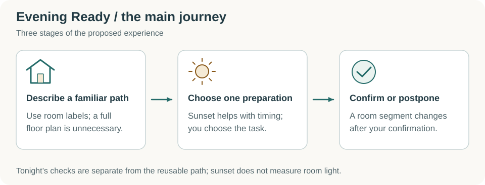
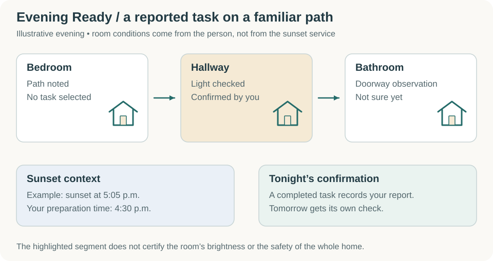

# Evening Ready — Prepare your evening path at home

[All seven ideas](00-final-project-ideas.md) · [Build guide](08-project-build-guide.md) · [Name review](09-project-name-review.md)

A home-preparation routine built around one familiar path.

**Planning estimate:** 32–46 / 46–64 active human team-hours for the first version / refined total. Strong without connected home hardware. These estimates assume coding-agent assistance and include human review; they are not measured development times.

## The idea in use

Evening Ready turns a vague intention to make the home easier to move through into one small completed action. It is designed around a familiar nighttime journey, such as the path from bed to bathroom.

The person creates a simple path with three room labels. They do not draw a floor plan. A short walkthrough asks them to notice lighting, objects in the way, and the location of things they use often. Each observation allows “Ready,” “Needs attention,” and “Not sure.” The person chooses one manageable preparation, such as checking a hallway light or arranging for someone to move an obstacle.

The app shows when sunset will occur and lets the person choose when they want to prepare. An evening preview illustrates the plan. When they mark the task complete, the related path segment lights up and the app states what they reported. The user has gained something concrete on the first day: a remembered task and a record that they completed it.

This is context-aware assistance. Without connected sensors, it does not continuously monitor the home or measure whether a room is sufficiently lit.

## The interaction to get right

Use tabs called Tonight, My Path, and History. My Path opens a room-detail stack. A task-editing modal handles the preparation time and wording. Tonight combines the simple room illustration, an evening timeline, and one prominent next action.

The signature interaction is the **evening preview**. Moving a time control changes the illustration from afternoon to dusk while a sentence explains the relationship to sunset. A standard time picker and text preview provide the same function without dragging or seeing the image. Completing a task gently brightens one segment; it does not paint the whole home green or certify safety. The icon is a doorway with a small warm light, and the splash uses the same subdued glow.

Use ordinary, respectful words. “You marked the hallway light ready” is better than “Fall risk eliminated.” A person can ask someone for help rather than being encouraged to move heavy furniture themselves.

## How to build it

An **API** is an interface through which one program requests data from another. Here the request returns sunset times. A **local notification** is a reminder scheduled on the phone. A **reducer** or **state machine** keeps track of permitted task changes, such as moving a task from planned to completed. See the [shared build guide](08-project-build-guide.md) for the common framework, database, accessibility, and delivery requirements.

Use the **Sunrise-Sunset.org API v2**. An example request is `GET https://api.sunrise-sunset.org/v2?lat=37.4275&lng=-122.1697&date=2026-11-05`. It returns local ISO timestamps and requires no key. Show the required attribution. A coarse locality is sufficient; the service does not need a home address or room description. Handle timezone changes, cached dates, and locations where a solar event is absent. See the [API documentation](https://sunrise-sunset.org/api).

Use `react-native-svg` for the room path, `react-hook-form` for the walkthrough, Zod for saved values and API responses, and optionally a stable compatible `xstate` with `@xstate/react` for explicit task states. [XState’s React integration](https://stately.ai/docs/xstate-react) supports modeling transitions such as planned, completed, and postponed; a simple reducer is adequate if it is easier to maintain. Do not introduce a state-machine dependency solely to increase the library count.

Use `expo-notifications` for optional local reminders after the main flow works. Notifications are a convenience, not a guaranteed alarm. The app must still show the plan when permission is declined. Its [notification documentation](https://docs.expo.dev/versions/latest/sdk/notifications/) explains the platform setup. Do not rely on a JavaScript process running continuously while the phone is locked.

Keep each evening’s tasks separate from the reusable path template, so yesterday’s completion cannot silently mark tonight’s check complete. Store `room_paths`, `observations`, `preparation_tasks`, `reminder_preferences`, and `task_events` in Supabase. Keep tasks private to their owner. The initial version needs no photographs, camera permission, or household account sharing. The walkthrough can draw on the topics in [CDC’s home checklist](https://www.cdc.gov/steadi/pdf/STEADI-Brochure-CheckForSafety-508.pdf), while making clear that it records user observations.

## Scope and effort

The first version includes one editable three-part path, a short walkthrough, a chosen task, sunset-aware scheduling, and completion history. Budget **32–46 active human team-hours**, or **46–64 hours total** for a more refined version over up to two weeks. Agents can quickly create alternative illustrations, forms, timing logic, and test cases. Human time should go into observing an actual home routine and removing awkward or patronizing interactions.

An early **three-to-four-hour experiment** should load sunset data, save a task, complete it, and reopen it on both platforms. A missing API response should fall back to a manually chosen preparation time with an explicit unavailable-data state. Aim for a complete evening ritual in the first few active days.

The best second-week refinement is to compare two experiences: a short room-by-room walkthrough and a single illustrated path with editable observations. Test which helps users select and finish a meaningful task with less explanation. Add reminders only when the base flow is stable. A local notification experiment can be bounded to a few hours before retaining an in-app schedule as the fallback.

**One carefully bounded hardware option** is reasonable if someone already owns a working Home Assistant setup and a compatible lamp. Its [REST API](https://contributors.home-assistant.io/core/internals/rest-api/) can request a light action, and its [authentication API](https://contributors.home-assistant.io/core/internals/auth-api/) governs access. This requires a real installation, credentials, and hardware; it is not an anonymous cloud service. Support one known lamp and show requested, reported, failed, or unknown state. Do not treat a successful HTTP response as proof that the room physically became bright. Allow roughly 8–16 additional human-hours beyond the refined core; do not purchase hardware or build device discovery merely to fill the second week.

## What could undermine it

The main concern is that a sunset animation can suggest more environmental awareness than the app possesses. Curtains, clouds, room orientation, and existing lights matter. Expo’s [light sensor is Android-only](https://docs.expo.dev/versions/latest/sdk/light-sensor/), so an iPhone lux meter is not a valid shared implementation assumption.

The product must distinguish sunset context from user-reported indoor conditions. Test dates across a timezone change, denied notifications, missing solar events, repeated completion taps, and an offline draft followed by retry. Observe whether users understand that a completed task is their confirmation, not an automated inspection. Do not add a camera model that claims to detect every hazard.

The demonstration should complete a real preparation, show the evening preview, and reopen the saved result. If a lamp integration is shown, identify whether it is real or simulated. Include an observed change in how easily a person completed the preparation. Evening Ready suits a team that wants to devote most of its time to that interaction and its accessibility.

[Back to the proposal comparison](00-final-project-ideas.md)
