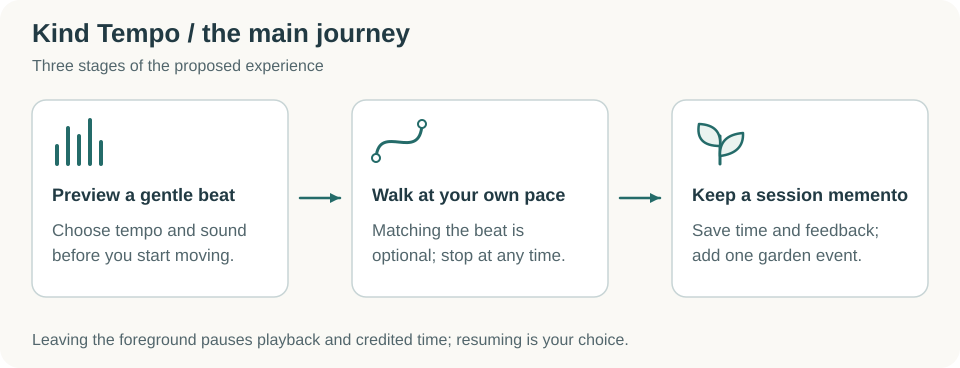
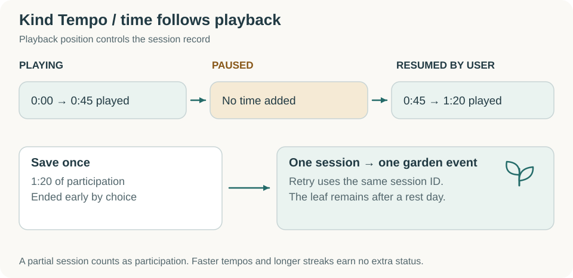

# Kind Tempo — A little rhythm for your next walk

[All seven ideas](00-final-project-ideas.md) · [Build guide](08-project-build-guide.md) · [Name review](09-project-name-review.md)

An optional walking rhythm with a garden that records participation.

**Planning estimate:** 30–44 / 44–60 active human team-hours for the first version / refined total. Strong if audio interruptions behave predictably. These estimates assume coding-agent assistance and include human review; they are not measured development times.

## The idea in use

Kind Tempo is a walking companion that provides a gentle, adjustable beat and a satisfying record of participation. It is for someone who finds ordinary exercise reminders uninviting and wants a small ritual that makes a short walk easier to begin.

The person first chooses a familiar indoor or outdoor setting for a two-minute session. If they choose outdoors, the app shows upcoming weather and helps them pick a time that matches their own rain and temperature preferences. They can always choose an indoor session instead.

Before walking, the person previews a few clearly labeled tempo choices while seated and chooses a comfortable one. The app starts a countdown, then plays a steady sound while the phone stays in a pocket. It never automatically speeds them up. At the end, they record whether the rhythm felt helpful, distracting, or uncomfortable. The next session remembers their preference.

The purpose is an enjoyable walking ritual, with optional beat matching and no claim to treat a gait disorder.

## The interaction to get right

Use tabs called Today, Sessions, and My Garden. A full-screen session modal contains a large Pause button, time remaining, and controls available before the walk begins. A settings detail screen exposes tempo, sound, accessibility, and privacy options.

The garden records participation through saved session time. A session might unfold one leaf. Ending early still saves the time spent and gives a quiet participation acknowledgement; completing the full duration is not required to earn it. The first session adds the first leaf, and a rest day preserves the garden. During walking, the interaction is primarily audio; the visual garden is for afterward. A screen reader announces “Session complete. Your garden has a new leaf.” Reduced-motion mode shows a static new leaf. The icon pairs a leaf with two small rhythm marks, and the splash repeats the same simple mark.

## How to build it

**Tempo** is the speed of a beat, usually expressed in beats per minute. **Foreground** means the app is open and active. An **audio clock** schedules sound in the playback system, avoiding the uneven timing that can occur when ordinary interface code schedules each beat. **Haptics** are the phone’s small vibration signals. See the [shared build guide](08-project-build-guide.md) for the common framework, database, accessibility, and delivery requirements.

Use **Open-Meteo’s forecast API** to populate a small outdoor-session planner. Compare forecast rain probability and temperature with preferences the person has chosen. Show the forecast time and source with the label “Matches your weather preferences.” Weather alone cannot establish whether an outing is suitable. A failed request leaves indoor and manual planning available. The data access conditions are described in [Open-Meteo’s terms](https://open-meteo.com/en/terms).

For the first focused core, have an agent generate original, full-length audio tracks for a few discrete tempo choices and two sound palettes. Play the bundled tracks with [`expo-audio`](https://docs.expo.dev/versions/latest/sdk/audio/). A two-minute session can use a two-minute file, which avoids loop seams and beat scheduling entirely. Use playback position as the source of elapsed session time; network delays and interface timers must not add credited walking time. Resume only after the person requests it, and let them save a partial session. Do not depend on Spotify or a JavaScript timer for audible timing.

Continuous tempo adjustment is a later extension using [`react-native-audio-api`](https://docs.swmansion.com/react-native-audio-api/docs/fundamentals/getting-started/) and its audio clock. That native integration is worthwhile only if the fixed-track experience has already passed user testing. It is not necessary for a strong demonstration.

Use `react-native-svg` for the garden, compatible Reanimated for optional transitions, and Zod plus TanStack Query for weather and settings. Haptics can acknowledge a button press, but they should not be the only rhythm channel. [Expo documents conditions in which haptics are unavailable](https://docs.expo.dev/versions/latest/sdk/haptics/).

Store `tempo_preferences`, `rhythm_sessions`, `session_feedback`, `garden_events`, and `weather_preferences` in Supabase. Derive garden changes from a unique session ID so a retried save cannot grow two leaves. Do not store microphone recordings; this app does not need the microphone.

## Scope and effort

The first focused core includes a fixed two-minute session, a few tempo choices, two sound palettes, pause and resume, weather-based time choices, saved feedback, and one carefully timed garden transition. Bundle playback for offline use. Cut adaptive pacing, motion sensing, live music analysis, social features, and background playback. Pause both playback and credited session time when the app leaves the foreground; keep the display awake and controls resistant to accidental pocket touches during a session.

Budget **30–44 active human team-hours**: 5–7 for choosing the ritual and sound direction, 12–17 for listening to alternatives and refining agent output, 8–12 for device and interruption testing, and 5–8 for accessibility and delivery. Agents can generate audio files, garden variants, state transitions, and persistence quickly. The human bottleneck is whether the sound feels pleasant and the app behaves predictably.

**Early feasibility experiment:** budget about two focused hours to play a complete track and handle Pause, Stop, and a foreground interruption on both phones. Complete the session-to-saved-garden flow early, then compare sound and completion designs with users. If playback remains unreliable after a bounded alternative, choose another concept instead of making a native audio engine the project.

For a refined version, budget **44–60 human-hours total**. The best second-week experiment compares a sparse beat with a gentle original soundscape, using the same duration and user-selected tempo. Ask which is inviting and which becomes tiring. If continuous tempo adjustment clearly improves the experience, allow a short native-audio experiment; otherwise spend the time on sound design and interruption recovery. The fixed tracks leave more time to refine the sound and session controls.

## What could undermine it

The main concern is that a metronome could distract someone or pressure them to walk at an unsuitable pace. The app must not make faster tempos a goal or promise rehabilitation. It should recommend trying the sound in a familiar setting and allow instant stopping. Users should set controls before moving and remain able to hear their surroundings.

Test audio timing under screen animation and network activity. Verify that every interruption produces an understandable state, rather than silent failure or an unexpected restart. Ask target users whether the sound reduces the effort of starting a walk; if they find it irritating, change the sound or make silent sessions equally rewarding.

The demonstration should show a weather-informed choice, a short session, an interruption handled cleanly, and a garden update saved exactly once. Its advantage is that agents can implement the bounded mechanics early, leaving several days for the refinements people will actually feel.

[Back to the proposal comparison](00-final-project-ideas.md)
