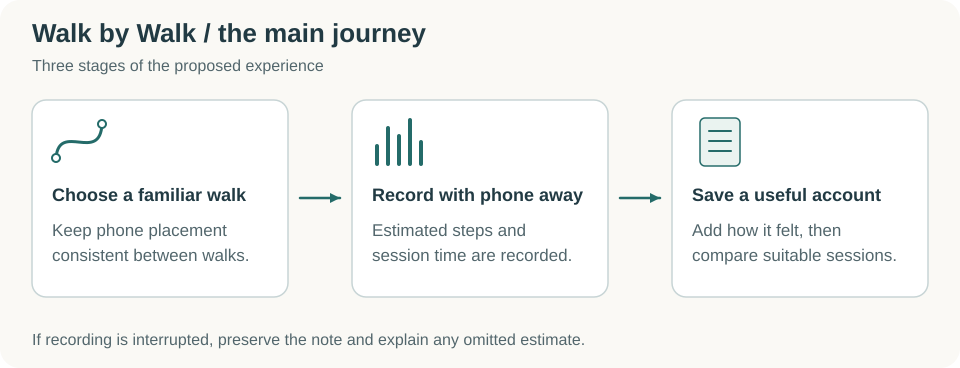

# Walk by Walk — A familiar walk, with room for notes

[All seven ideas](00-final-project-ideas.md) · [Build guide](08-project-build-guide.md) · [Name review](09-project-name-review.md)

A walking journal with estimated step counts and comparisons.

**Planning estimate:** 36–52 / 50–72 active human team-hours for the first version / refined total. Conditional on useful step estimates on both phones. These estimates assume coding-agent assistance and include human review; they are not measured development times.

## The idea in use

Walk by Walk is a small walking journal that turns a short, familiar walk into a clear record of the walking session and how it felt. It is for someone who wants to notice changes in their walking routine without buying a wearable or interpreting a medical dashboard.

On the first screen, the person chooses a familiar, unobstructed route and says whether it is indoors or outdoors. The app explains how to carry the phone consistently, such as in the same secure trouser pocket. The person starts a short session and walks at their own comfortable pace. Spoken start and finish cues let them keep the phone put away. The session screen stays awake and guards against accidental touches. If the app backgrounds or the phone locks, the recording is marked interrupted rather than silently treated as complete. They can stop at any time.

Afterward, the person sees the session duration, estimated step count, estimated average steps per minute across the session, and a question about how the walk felt. The person can save a note such as “I used my usual walking aid.” They can compare two walks with similar routes and phone placement, including two recordings made on the same day. Longer-term trends are useful later, but are not necessary for the first demonstration.

With an empty account, the first result is simply “Your first walk is saved,” followed by its record and an optional note. No comparison or improvement claim is invented. The longer-term value is a more concrete conversation about what changed. A higher estimated cadence is not automatically a better walk.

## The interaction to get right

Use tabs called Today, My Walks, and Compare. Today opens a guided session modal. My Walks opens a session-detail stack. The result layout combines one large metric, a simple session strip, a plain-language interpretation, and an expandable recording-information panel. The strip shows elapsed and paused portions that the app actually recorded. It does not pretend to show individual foot strikes.

Two saved cards align to make their differences easier to see. A brief, optional vibration confirms a save. The screen-reader version says, for example, “One-minute session. Estimated average: 92 steps per minute. No app interruption recorded.” It does not claim that the absence of an interruption proves measurement accuracy. The icon is a single curved footprint line. The splash uses that line on a warm cream background.

## How to build it

**Cadence** means steps per minute. Here it is an estimate averaged over the entire session. A **pedometer** counts steps; an **accelerometer** measures changes in the phone’s motion. Sampling at **50 Hz** means requesting 50 readings per second. A **state machine** records allowed transitions, such as recording, interrupted, and saved. See the [shared build guide](08-project-build-guide.md) for the common framework, database, accessibility, and delivery requirements.

Use the foreground Pedometer interface from `expo-sensors` for the first focused core. Compute average steps per minute from the reported count and the explicitly recorded session duration, and label it average steps per minute across the session. Unrecorded resting time remains in the denominator; this is not cadence measured only during uninterrupted walking. The [Pedometer documentation](https://docs.expo.dev/versions/latest/sdk/pedometer/) describes background and platform limitations. Check availability and permissions on the actual phones. An OS estimate still needs evaluation on the intended walking styles.

An accelerometer experiment is a later extension. The [sensor documentation](https://docs.expo.dev/versions/latest/sdk/sensors/) provides the hardware interface, not a gait algorithm. If adding a motion trace, label it phone motion. A target such as 50 Hz requires checking actual timestamps; the requested interval does not prove uniform sampling. Do not manufacture step timing from aggregate pedometer updates.

The external HTTP API is **Open-Meteo**. Request temperature, precipitation, and wind for a user-selected area. The response adds a timestamped label for the selected area and hour. Store whether it is a forecast or a retrospective weather estimate, together with its units and source. Filters compare those saved estimates; they do not imply that the phone measured the weather along the walk. Label indoor walks “Indoor” and omit outdoor-weather comparisons for them. This makes the API part of comparison quality. It is not a gait-analysis API. [Open-Meteo documents these variables](https://open-meteo.com/en/docs).

Use `simple-statistics` for summaries across sessions, `react-native-svg` for comparison strips, and the shared Query and Zod packages for network state and validation. The [Simple Statistics API](https://simple-statistics.github.io/) supplies numerical operations; it does not turn aggregate steps into balance or symmetry measurements.

In Supabase, store `walk_sessions`, `session_metrics`, `context_notes`, and `weather_snapshots`. Keep the measurement method, phone placement, interruption flags, and source beside each metric. Save summaries by default. If the later sensor experiment is added, retain actual sample coverage and method version, and keep original motion readings temporary and local unless the person explicitly exports one. Read saved sessions into the history and update notes to demonstrate both database directions.

## Scope and effort

The first focused product contains one short foreground recording flow, editable notes, weather context, saved history, and a two-session comparison. It handles denied permissions and interrupted sessions. Cut bespoke gait algorithms, long-term predictions, background sensing, health imports, and medical scores. These cuts leave time to make the comparison unusually clear.

Budget **36–52 active human team-hours**. Expect approximately 6–8 hours for scope and design choices, 12–16 for observing and directing agent revisions, 12–18 for physical-device and measurement checks, and 6–10 for accessibility and delivery. Agents should implement the session state machine, storage, comparison variants, and repeatable test setup. Human reviewers must decide whether the measurements and explanations deserve to be shown.

**Early feasibility experiment:** budget about four focused hours to determine whether a complete session returns sensible counts on both phones. If it fails, investigate one bounded alternative before keeping duration and manual notes only; that fallback has a lower gait-analysis ceiling. Aim to save and reopen real sessions in the first few active days, then compare two interface approaches with users.

For a refined version, budget **50–72 human-hours total**. The best second-week work is a broader measurement check and a better comparison explanation. Try a numerical comparison against an annotated session card and ask users what they think changed. A small raw-motion experiment is optional only if its purpose and limitations are clear. Do not spend the extra week building an unvalidated gait score.

## What could undermine it

The main concern is that this could be a pedometer dressed up as a medical instrument. Pocket position, clothing, walking aids, turns, and phone handling can change the signal. An accelerometer peak is not automatically a foot strike. Do not label aggregate count differences “balance,” infer left-right differences, or apply published accuracy numbers from someone else’s algorithm.

The response is to make recording conditions and limitations part of the product. Compare reported counts with manually counted steps in consented, comfortable walks on both phones. Include pauses, slow walking, different pockets, and deliberate phone handling. Report observed errors and failures alongside the sample size and conditions, keeping the conclusion limited to that engineering evaluation. If the sensor is unavailable or interrupted, retain the duration and personal note and explain why the estimate is omitted. Do not suggest that the app can detect every inaccurate but apparently valid count.

The demonstration should show one normal recording, one interrupted recording, and a clear comparison. Explain the observed count errors and show how a failed recording remains useful as a personal note.

[Back to the proposal comparison](00-final-project-ideas.md)
