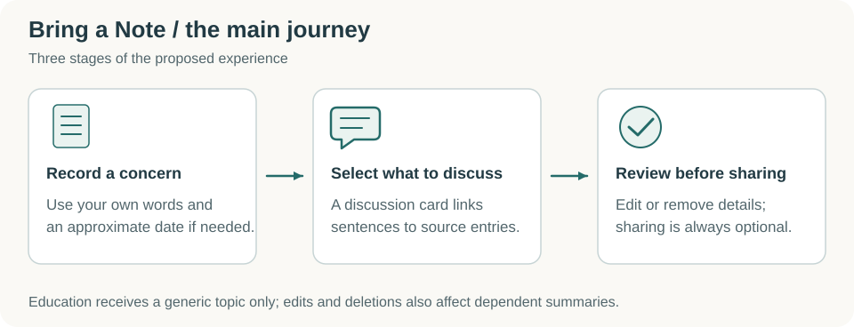
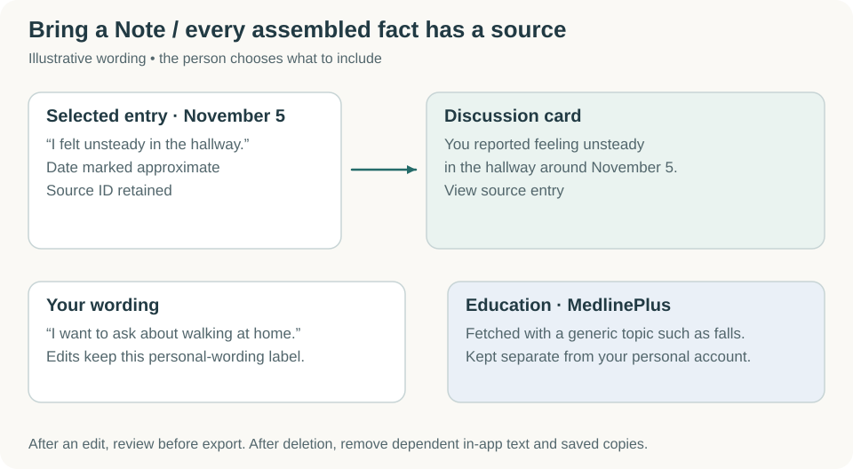

# Bring a Note — Bring a clearer account to your next appointment

[All seven ideas](00-final-project-ideas.md) · [Build guide](08-project-build-guide.md) · [Name review](09-project-name-review.md)

A private mobility-concern diary with an editable discussion card.

**Planning estimate:** 34–50 / 48–68 active human team-hours for the first version / refined total. Strong if summaries remain faithful through edits and deletions. These estimates assume coding-agent assistance and include human review; they are not measured development times.

## The idea in use

Bring a Note helps an older adult organize mobility concerns and prepare a clear account for a conversation with someone they trust or a healthcare appointment. It focuses on what the person noticed, what they want to discuss, and what action they chose.

The person records a concern using a short form. They might note a recent near miss, feeling unsteady, or worry about falling. They can use an approximate date, say “Not sure,” or skip a question. The app asks what they would like to do next and offers a relevant educational resource. It does not generate a diagnosis.

As entries accumulate, the person sees a factual timeline. They choose the entries they want to discuss, and the app assembles an editable discussion card. Automatically assembled sentences link to their source entries. Text the person changes or adds is labeled “Your wording.” The person can correct the wording, remove a sensitive detail, and save the summary. A share sheet is opened only when they explicitly choose to share.

The first-day value is a useful record and a more concrete next step. Later change summaries can draw attention to reported concerns without pretending to predict an individual fall.

## The interaction to get right

Use tabs called Check In, My Story, and Next Steps. My Story has entry-detail and edit screens. A summary-review modal lets the person select and revise information before export. A clear distinction separates “What you reported” from “Information from MedlinePlus.”

The signature interaction is a **discussion card that shows its sources**. As the person selects entries, fixed templates assemble a readable account. Tapping an automatically assembled sentence highlights its source entry; a labeled button provides the same action for screen readers. User-edited sentences retain an explicit “Your wording” label rather than implying the source contained those exact words. Acknowledge completing the chosen action, without rewarding particular symptom answers. The icon is a speech bubble formed from two simple stepping stones, with the same shape on the splash screen.

## How to build it

**XML** is a tagged text format used by the education service. A **parser** reads that format into data the app can use. **Deterministic templates** produce sentences by fixed rules, so the team can trace every fact to a selected entry. A **snapshot** is a saved copy of the information at a particular time. See the [shared build guide](08-project-build-guide.md) for the common framework, database, accessibility, and delivery requirements.

Use the **MedlinePlus Web Service** for related education. For example, `GET https://wsearch.nlm.nih.gov/ws/query?db=healthTopics&term=falls&retmax=3` returns relevant health-topic records in XML. Send a generic, preapproved topic term selected from the user’s chosen concern, not their personal narrative or identity. Attribute the information and link to its source without implying endorsement. The service is free, requires no registration, and recommends caching. See the [official service documentation](https://medlineplus.gov/about/developers/webservices/).

Use [`fast-xml-parser`](https://github.com/NaturalIntelligence/fast-xml-parser) to parse the response, `react-hook-form` for entries, Zod for validation, and `react-native-svg` only where a graphic improves the timeline. Bound the response size, normalize text, and treat embedded markup and links as untrusted input. Use deterministic sentence templates for summaries. An LLM adds a substantial verification burden to a task where the person’s own words and accurate counts are sufficient.

Store `concern_reports`, `check_ins`, `chosen_actions`, `discussion_questions`, `summary_snapshots`, and `education_cache` in Supabase. A summary snapshot should keep the selected entry IDs and generation time. Editing an entry makes dependent drafts visibly out of date. Block export until the person reviews or regenerates those drafts. Deleting an entry removes or regenerates dependent in-app summaries and cached text, including edited copies of those summaries; it must not leave the deleted concern hidden in a second copy. Independently written discussion notes remain separately editable and deletable. An already exported file cannot be recalled; tell the person this before sharing sensitive material.

CDC’s [STEADI resources](https://www.cdc.gov/steadi/about/index.html) provide a basis for relevant topics, but the proposed form is a concern diary, not a validated clinical screen. If reproducing a formal screen later, retain its protocol and obtain appropriate content review. Do not silently convert adapted questions into a risk category. The educational API does not calculate risk.

## Scope and effort

The first version contains private concern reports, an editable timeline, relevant education, one chosen action, and a deterministic discussion card. Budget **34–50 active human team-hours**, or **48–68 hours total** for a refined version within two weeks. Agents can implement the forms, source-linked templates, data updates, and alternate summary layouts. Humans should spend their review time checking that the summary is faithful and that users understand its purpose.

An early **three-to-four-hour experiment** should create an entry, edit it, reopen it, fetch a relevant article, and generate a correct summary. Deliberately delete an entry and verify that the summary does not silently retain it as current information. By the first complete version, the whole report-to-summary flow should work with one real entry and an empty history.

The best second-week refinement is a comprehension test of two discussion-card layouts. Ask users which details they would share, which sentence came from an educational source, and whether the app told them anything about their chance of falling. If the last answer is yes, revise the wording. Add user-invoked export through [`expo-print`](https://docs.expo.dev/versions/latest/sdk/print/) and [`expo-sharing`](https://docs.expo.dev/versions/latest/sdk/sharing/) if useful, while preserving an accessible in-app text version. Do not add automatic family alerts, caregiver accounts, a cloud-sharing portal, medication recommendations, or mandatory gait sensors.

## What prediction would require later

The short-term feature is **transparent change reporting**: a clear account of what the person entered and when. It may say, “You reported unsteadiness on three of five completed check-ins.” It must not treat two missing days as days without concern. More reports could reflect increased use of the app rather than worsening mobility.

A later predictive study would need consented longitudinal records, clearly defined fall outcomes and prediction horizons, enough representative participants, and appropriate clinical collaboration. Evaluation would separate people and future time periods, compare a simple baseline, check whether predicted probabilities match observed frequencies and count false alarms, and test performance for relevant subgroups. A prototype trained on synthetic records cannot establish these properties. Implementing a model quickly does not remove those evidence requirements.

## What could undermine it

The main concern is that a sophisticated-looking summary could become an unsupported medical judgment. A colored risk gauge is especially tempting and should be excluded. The app should also avoid suggesting that negative answers mean someone is safe or that a missed check-in proves an emergency.

Test summaries against selected records, missing answers, duplicate saves, corrected dates, and deletions. Verify that two accounts remain isolated and that education still works without transmitting personal notes. Ask target users to explain the card’s source and limitations. Keep sample histories clearly labeled as demonstrations.

The demonstration should turn one real concern into a faithful, editable account, trace a sentence back to its entry, and show the person choosing a next step. Include evidence that the person understood the card and chose what to share. The source-linked review is the feature that gives this proposal depth.

[Back to the proposal comparison](00-final-project-ideas.md)
