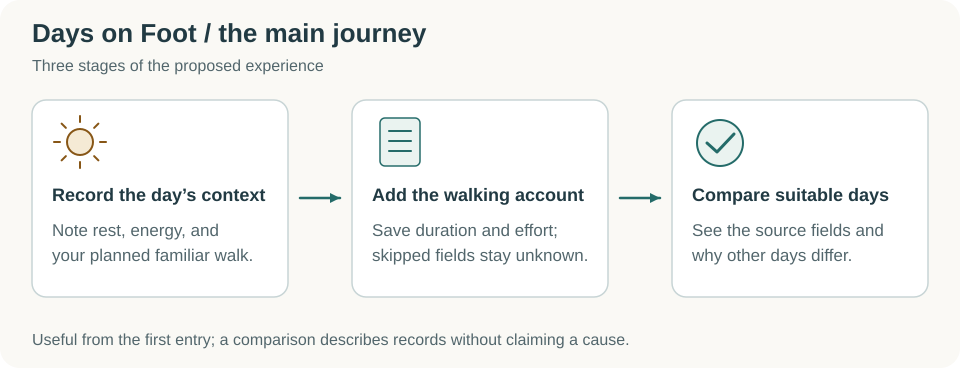
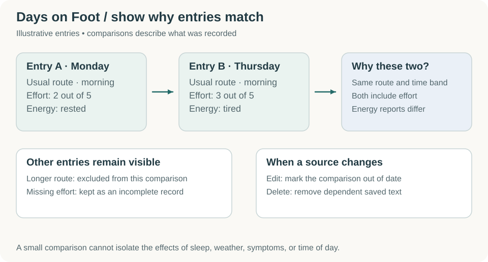

# Days on Foot — Remember what shaped a walk

[All seven ideas](00-final-project-ideas.md) · [Build guide](08-project-build-guide.md) · [Name review](09-project-name-review.md)

A diary that compares walking experiences and their context.

**Planning estimate:** 30–44 / 44–62 active human team-hours for the first version / refined total. Strong for a diary; personal predictions remain research. These estimates assume coding-agent assistance and include human review; they are not measured development times.

## The idea in use

Days on Foot is a personal observation journal for someone who wonders why walking feels easier on some days than on others. It connects a few ordinary details, such as sleep, energy, time of day, and weather, with the person’s own account of a familiar walk.

The person opens Today and answers three short questions. They record how rested they feel, how much energy they have, and which familiar walk they plan to take. After the walk, they enter its duration and how difficult it felt. They can skip a question or say that they do not know. The app immediately creates a useful diary entry, even without sensor access or previous records.

When another comparable entry exists, the person can place the two side by side. The app points out what matches and what differs. It might say, “These were both morning walks on your usual route. You reported less energy on Tuesday.” It can explain why it excluded another entry, such as a much longer route. With a longer history, the person can choose a question to observe, such as whether their usual walk feels different after more restful nights.

The app encourages observation of ordinary routines. It does not ask people to deprive themselves of sleep, change medication, or continue walking through symptoms. The immediate purpose is remembering accurately; any discovery about personal patterns comes later.

## The interaction to get right

Use tabs called Today, My Days, and Discover. A day-detail stack contains the original entry and an edit screen. A comparison modal places two cards side by side or vertically when text is large. The main layout gives equal importance to the user’s words and the recorded numbers.

The memorable interaction is “Why these two days?” Tapping it highlights the fields that made the entries comparable. A second action shows excluded days and the reason. A quiet page-turn transition gives the journal personality without turning health into a competition. A missing day appears as an empty space, not a failure. The icon is a small sun partly enclosed by an open notebook; the splash uses the same illustration.

## How to build it

**Descriptive statistics** summarize existing entries. **Machine learning (ML)** fits a pattern to examples to estimate an unknown result. A **baseline** is a simple comparison method that a more complex model must improve upon. **Data leakage** happens when training uses information that would not have been available at the time of a real prediction. See the [shared build guide](08-project-build-guide.md) for the common framework, database, accessibility, and delivery requirements.

Use **Open-Meteo** for a timestamped weather snapshot at the time of an outdoor entry. The response supplies small context labels and comparison filters. A coarse, user-selected area is sufficient; the weather service does not need the diary, name, or exact route. Label the saved source as a forecast or a retrospective estimate. For a past entry, use a properly labeled historical source or leave weather unknown. Historical weather is typically reconstructed from models and observations, rather than measured at the person’s exact location. Do not attach today’s forecast to yesterday’s walk. The [historical weather documentation](https://open-meteo.com/en/docs/historical-weather-api) distinguishes retrospective data from forecasts.

Use `react-hook-form` for the diary, `simple-statistics` for descriptive summaries, `react-native-svg` for the comparisons, and the shared Query and Zod packages. Start with explicit comparison rules that the person can understand. Sorting similar entries is valuable without calling it a trained AI model.

Store `day_entries`, `walk_observations`, `observation_questions`, `weather_snapshots`, and `comparison_snapshots` in Supabase. A snapshot should retain the source-entry IDs and comparison-method version. Keep personal effort ratings separate from any later sensor estimates. Editing an entry invalidates a comparison that depended on it. Deleting an entry removes or regenerates dependent comparison snapshots and cached text, so deleted details do not remain in another copy.

**A credible ML extension** would predict the person’s reported effort for a future familiar walk using a few preselected inputs. A small regression model—an equation fitted to predict a number from a few inputs—would be easier to inspect than a large neural network. The Ridge method in scikit-learn discourages extreme fitted weights, reducing its tendency to fit noise in a small dataset.

Use only information available before the walk as inputs; actual duration, post-walk difficulty, and later weather observations cannot be prediction inputs. Evaluate on later dates, compare against the person’s median effort rating, the middle value of their previous ratings, and hide the prediction unless it improves accuracy on later entries that were kept out of training. Agree on the error measure before inspecting those results. Compute input transformations only from the training records, and test on a later date range. Repeatedly adjusting the model to match that test range would undermine the evaluation. See [scikit-learn’s leakage guidance](https://scikit-learn.org/stable/common_pitfalls.html) and [Ridge documentation](https://scikit-learn.org/stable/modules/generated/sklearn.linear_model.Ridge.html).

That model can be implemented within the project window, but a new user will not supply enough varied, representative observations to establish trustworthy personal prediction in one or two weeks. A synthetic history can demonstrate interface states if it is conspicuously labeled. It cannot demonstrate model effectiveness. Predicting reported effort also does not establish that a lifestyle change improves gait.

Optional future imports use [`@kingstinct/react-native-healthkit`](https://github.com/Kingstinct/react-native-healthkit) on iOS and [`react-native-health-connect`](https://github.com/matinzd/react-native-health-connect) on Android. These require native setup, permissions, compatible devices, and actual records. They are device interfaces, not the external HTTP API. Their available measurements are not identical; [Health Connect’s availability rules](https://developer.android.com/health-and-fitness/health-connect/availability) add further constraints. Manual input remains the shared core.

## Scope and effort

The first complete version contains a short manual diary, weather context, two-entry comparisons, and an editable observation question. It should take **30–44 active human team-hours**. Allow **44–62 hours total** for a more refined version within two weeks. The extra time is best spent on comparison explanations, actual diary use, and accessible editing, rather than mandatory health imports.

Agents can implement alternate journal layouts, comparison rules, clearly labeled sample records, and tests that mark comparisons out of date after an edit. Human effort should concentrate on whether entries are quick to create and whether the app’s wording overstates the evidence. A useful first experiment compares a three-question form with a conversational-looking card flow. Observe completion and understanding, then keep the simpler design.

Aim to have the diary and Supabase save-and-reopen flow working in the first two or three active days. Spend several subsequent days using the diary naturally. In a second week, improve the “Why these days?” view based on actual confusion. Do not make a predictive model a condition of completion. An optional research branch can demonstrate the evaluation process while remaining clearly separate from the user-facing claims.

## What could undermine it

The main concern is that this is an ordinary journal decorated with unjustified correlations. Sleep, weather, route, symptoms, and time of day can change together. Many measurements from one walk are not many independent days. Missing entries can also distort a pattern.

The response is to show the underlying entries, the number of observations, missing fields, and competing explanations. Test comparisons with contradictory, sparse, edited, and deleted records. A legitimate result may be “There is not enough comparable information yet.” Two target users should be able to explain why the app compared two entries without help from the team.

Choose Days on Foot for its diary and comparison experience. A later prediction study would need substantially more real observations; the course version should stand on the usefulness of the records people create now.

[Back to the proposal comparison](00-final-project-ideas.md)
