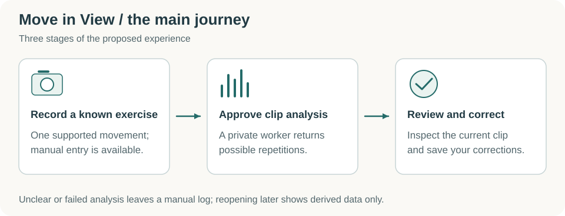
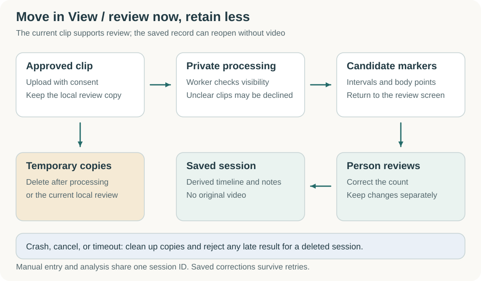

# Move in View — Review the repetitions your camera counted

[All seven ideas](00-final-project-ideas.md) · [Build guide](08-project-build-guide.md) · [Name review](09-project-name-review.md)

An exercise log with a correctable camera replay.

**Planning estimate:** 50–70 / 70–100 active human team-hours for the first version / refined total. Highest integration risk; prove the deployed video processing flow first. These estimates assume coding-agent assistance and include human review; they are not measured development times.

## The idea in use

Move in View helps someone record exercises they already know how to perform and review what the camera could observe. It is useful for a person following an established exercise routine who wants a better record than a handwritten repetition count.

The person chooses the one supported exercise or enters a manual exercise log. A camera-placement illustration helps them position the phone; the first focused version does not promise an automated live setup check. The person records a short clip, reviews it, and chooses whether to upload it for analysis. The worker checks visibility afterward and can return an explanation instead of a count. Reject clips with more than one visible participant or an unsupported camera view, and keep the manual log available.

While analysis is pending, the person can save a manual log immediately. The analysis result is a replay of the current local clip with a simple body-landmark overlay and candidate repetition markers. The person can select a marker, see the corresponding movement, and correct the count. If the camera loses sight of a joint, the app says so. The person saves the corrected result and a note about how the session felt.

The initial automated exercise should be a low-complexity, seated movement already suitable for the participant, such as a seated knee extension. The team should not prescribe it universally. Standing balance challenges and unsupervised clinical chair-stand tests are excluded.

## The interaction to get right

Use tabs called Practice, My Sessions, and Progress. Practice opens the supported exercise’s detail screen. Recording and the current replay use a modal flow. A saved session opens its landmark timeline, corrected counts, and notes without the original video. The current replay combines video, a short timeline, correction buttons, and an accessible textual account.

Selecting “Repetition 3” moves the replay to the movement that produced it, so the person can check the count. The result can say, “Six possible repetitions; two sections were unclear. Review or edit the count.” It should never scold the person for imperfect form. Large Previous and Next buttons provide an alternative to scrubbing. The icon is an open circular arrow around a small movement line, with the same mark on the splash screen.

## How to build it

**Computer vision** is software that interprets images. A **pose landmark** is an estimated body point, such as a knee. **Inference** means running a trained model on a new clip. A **worker** is a separate server process that handles a long-running task. **Occlusion** means a body part is hidden from view; it can make the estimate unreliable. See the [shared build guide](08-project-build-guide.md) for the common framework, database, accessibility, and delivery requirements.

Use the public **wger exercise API** for descriptive exercise information. The original research notes report a successful request to `https://wger.de/api/v2/exerciseinfo/?limit=1`, with results split across pages. That request was not repeated during this revision. Current records contain `translations`, image metadata, and license information; do not assume an old example with a flat `name` field. Select a small set of suitable entries, preserve source and per-item attribution, and handle missing media. wger is a general exercise resource, not a geriatric rehabilitation prescription service. See its [API documentation](https://wger.readthedocs.io/en/latest/api/api.html).

Use `expo-camera` for recording, `expo-video` for replay, `react-native-svg` for overlays, and the shared Query and Zod packages for jobs and responses. The computer-vision component is **MediaPipe Pose Landmarker**, initially running in a small Python worker. Google’s [Pose Landmarker documentation](https://developers.google.com/edge/mediapipe/solutions/vision/pose_landmarker) includes Python video-frame processing and separate browser examples. The browser examples are not a drop-in React Native integration.

The app uploads a short, explicitly approved clip to private Supabase Storage. A server endpoint creates a job. A Python worker downloads the clip with limited authorization, extracts landmarks, computes candidate repetition intervals, and writes results. The app polls a job-status endpoint and offers Cancel and Retry. Supabase Edge Functions can authenticate and coordinate this process; a separate compute worker should perform video decoding and Python inference.

Store `exercise_catalog_cache`, `practice_sessions`, `analysis_jobs`, `rep_events`, and `user_corrections` in Postgres. Keep method and model versions. Link the manual log and analysis to one stable session ID so a late result updates that session instead of adding a duplicate. Keep the person’s corrections when a request is retried.

Use short-lived file access, upload size limits, and job timeouts. Delete cloud and worker video copies after processing or cancellation, with cleanup for abandoned jobs. Keep the original local clip only for the current review and delete it when that review ends. Add cleanup on the next app launch for clips abandoned by a crash, and a server cleanup job for failed or abandoned uploads. Set and disclose a maximum retention period before collecting participant videos; deletion from active storage does not establish erasure from provider backups. Reopened sessions contain the derived timeline and corrected counts. Deleting a session removes its derived data too, and a late worker result must not recreate a canceled or deleted session. Explain this lifecycle before upload. Keep corrected counts separate from model counts so correction does not masquerade as model accuracy.

## Scope and effort

The first focused version supports one movement, short clips with a strict size limit, one worker, one replay, manual correction, and deletion. Fetch the wger reference card for the selected movement instead of building a large searchable catalog. Use explicit retry rather than resumable background uploads. Retain job timeouts and cleanup; those are essential even in a small prototype. Cut real-time inference, custom model training, form scoring, multi-person tracking, and a general exercise recommender.

Budget **50–70 active human team-hours**, conditional on a successful early feasibility test: 6–8 for scope and camera design, 16–22 for reviewing integration and replay revisions, 20–28 for annotating clips and checking processing/privacy failures, and 8–12 for accessibility and delivery. Agents can implement the API, worker, and replay in parallel. People must examine whether every counted movement and every uncertainty message is credible. This is the least predictable proposal in the set.

**Early feasibility experiment:** budget about six focused hours to process a newly recorded clip from each platform through a deployed worker and return candidate counts. Confirm that a suitable wger item exists. If the gate fails, allow a bounded second approach before committing to the camera concept. If only manual logging works, reassess the proposal around that reduced capability. Aim for a complete capture-to-correction flow in the first three to five active days. Once it works, hold the model and movement stable while improving replay clarity, failed jobs, deletion, and varied clips.

For a refined version, budget **70–100 human-hours total** and use most of the second week for actual clips and camera setup. Compare a full skeleton overlay with a simpler repetition timeline that reveals landmarks only on request. Keep whichever helps people correct a count with less confusion. Expand to a second movement only if the first has reliable behavior across the tested conditions and no unresolved privacy or platform failures.

## What could undermine it

The main concern is that a skeleton overlay can look authoritative while being wrong. Occlusion, camera angle, loose clothing, assistive devices, and lighting can all affect landmark detection. A two-dimensional angle should not become a diagnosis of unsafe technique. An upload also exposes identifiable video, even if the model only needs joints.

Test consented clips with manually counted repetitions, different bodies, camera positions, and deliberate occlusion. Measure count errors and the proportion of clips for which the app declines to produce a result. Test whether errors are concentrated in particular conditions. A failed clip should still produce a useful manual log. Confirm that deletion also handles failed jobs and worker copies.

The demonstration should show the model making an uncertain observation and the person correcting it. It shows whether a person can understand and correct the result.

[Back to the proposal comparison](00-final-project-ideas.md)
